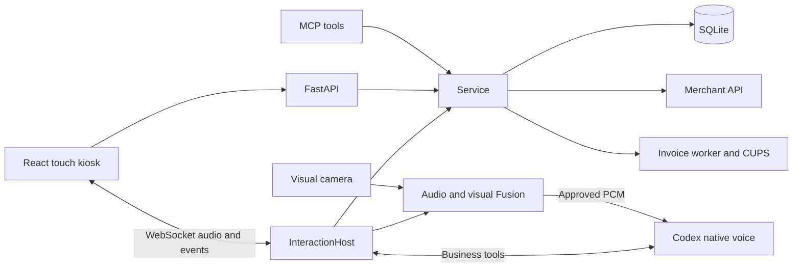

# Onboarding Guide: Trend Coffee

## Overview

Vietnamese customer-service kiosk with touch and voice ordering, sourced menu answers,
merchant payment QR, order progress and invoice printing. HTTP, MCP and native voice
share a Python business service; camera/audio Fusion controls who may speak to it.

Refreshed 2026-10-24 against the consistent-voice handoff and current source.
Avatar architecture and measured limits were added 2026-10-31.
Avatar refresh 2026-11-02: 2D was cancelled; the active path is the whole-face Ditto talking head.
Start with [PROGRESS.md](PROGRESS.md) (later entries supersede earlier ones),
[selected-voice evidence](evals/consistent-kiosk-voice.md) and, for latency,
[voice latency evidence](evals/voice-connection-latency.md), especially its final section.
The root AGENTS.md still describes an empty scaffold; the implementation now exceeds
that description. No root CodeGraph index or usable Git repository was found.

## Tech stack

| Layer | Technology / declared constraint |
|---|---|
| Backend | Python ≥3.12, FastAPI ≥0.115,<1, Pydantic validation, uvicorn |
| Persistence | SQLite WAL + FTS5, direct SQL; schema in `trendcoffee/store.py` |
| Kiosk | React 19, TypeScript ~6.0, Vite 8, Tailwind 4, Radix components |
| Voice | Codex native voice, backend aiortc WebRTC; Luna/medium, priority tier |
| Perception | Local `Visual/`, `Audio/`, `Metric3D/`; separate model environments |
| Tooling | uv/Hatchling, pytest, Ruff; npm/Vitest, oxlint, Prettier |

Root packaging uses `pyproject.toml` and `uv.lock`; frontend has its own package lock.
No root CI workflow or coverage threshold was found. Perception directories contain
their own Git metadata; root Git history is unavailable for convention detection.

## Architecture and directory map

| Location | Responsibility / first file to read |
|---|---|
| `trendcoffee/cli.py`, `__main__.py` | `trendcoffee` command, HTTP/MCP startup and import |
| `trendcoffee/api.py`, `mcp_server.py` | REST schemas/auth, kiosk socket, MCP adapters |
| `trendcoffee/service.py`, `store.py` | Pricing, freshness, guest ownership, idempotency, persistence |
| `trendcoffee/agent.py`, `semantic.py` | Local text intent routing and optional evidence selection |
| `trendcoffee/kiosk.py` | Guest lifecycle, shared cart, voice tools, reconnect/preparation |
| `trendcoffee/codex_voice.py`, `native_peer.py` | Model instructions, native connection, PCM/transcripts/teardown |
| `trendcoffee/av_transport.py`, `av_worker.py`, `visual_worker.py` | Fusion IPC and perception integration |
| `trendcoffee/avatar.py`, `scripts/ditto_server.py`, `scripts/ditto_realtime.py` | Avatar proxy, WebRTC server, GPU mouth generation and presentation |
| `trendcoffee/merchant.py`, `invoices.py`, `printer.py` | Checkout verification, invoice scheduling and CUPS |
| `frontend/src/App.tsx`, `state.ts`, `api.ts` | Touch ordering, state and typed HTTP client |
| `frontend/src/useKioskVoice.ts`, `voiceAudio.ts`, `frontend/public/voice-playback.js` | Voice socket, capture/playback lifecycle |
| `scripts/prepare_voice_clips.py`, `frontend/public/voice/catalog.json` | Offline native greeting/farewell preparation and PCM provenance |
| `trendcoffee/static/` | Built kiosk plus staff console/assets; rebuild React sources |
| `data/`, `docs/`, `tests/`, `scripts/` | Public knowledge, evidence/workflows, regressions, launcher/timer |
| `.runtime/`, `output/` | Local DB/process records/logs/models; probe evidence, respectively |

## Request lifecycle

Touch checkout calls `api.checkout` from `App.tsx` when operating through HTTP.
`POST /api/checkout` validates strict Pydantic input and the bearer guest capability,
then calls `Service.checkout`. The service validates fulfillment, catalog freshness,
options and prices, binds normalized notes to the checkout ID, persists the quote/order
through `Store`, and invokes the merchant adapter when enabled. The response supplies
verified order/payment data for the inline QR. QR availability does not mean paid.

With a controlled voice session, touch commands and native `kiosk_checkout` share
`InteractionHost`'s cart and reach the same service. Browser microphone PCM passes
through Fusion before native voice receives it. Native speech returns through backend
WebRTC and the browser AudioWorklet. Guest generations reject retired events.

For voice selection, `useKioskVoice.ts` loads `/api/kiosk/voices` and remembers
`trendcoffee.voice` in localStorage. Maple is the default only when no preference
exists; an explicit native default remains valid. `InteractionHost` captures
`session_voice` at guest start for greeting, live conversation and farewell.
Mid-session changes apply to the next guest. Only native choices with both WAVs
are offered; the last verified asset set has 23 named voices plus default.
Porto/Selva were denied upstream. Source clips in `frontend/public/voice/` are
copied by Vite into `trendcoffee/static/voice/`, where the backend reads them.

### Avatar path

Settings → Nhân vật offers Avatar 3D (the existing Ditto path, default) and Pet (added
2026-11-03 from OpenJarvis). The selection persists in `trendcoffee.character` and is
locked while the microphone is armed/connecting. `PetAssistant.tsx` uses procedural
Three.js geometry and existing assistant phases: waiting/off → idle, connecting →
thinking, listening → listening, actual PCM playback → speaking, unavailable → error.
Pet connects directly to `VoicePlayer`, never `/api/avatar`; voice, microphone capture,
Fusion and guest lifecycle remain shared. WebGL failure/context loss falls back to an
SVG robot. Pet code is lazy loaded and supports reduced motion. No ML model or external
3D assets are needed for Pet. The cancelled 2D model path remains cancelled.

Assistant PCM reaches `AvatarPlayer` through `useKioskVoice.ts`; the player sends
audio to the avatar over the `/api/avatar` WebSocket, which proxies the local
Ditto server. `ditto_realtime.py` generates motion on a GPU worker; a separate
presenter supplies video over WebRTC to `AvatarAssistant.tsx`. Native speech
playback remains independent of that video. Expression calibration and the
opening limit live in `trendcoffee/avatar_expression.py`; `.runtime/trend-avatar.json`
selects the local profile. See [avatar workflow](workflows/realtime-avatar.md) and
[opening-limit evaluation](evals/avatar-opening-limit.md) for setup and evidence.

**Current profile (2026-11-02): whole-face Ditto talking head**, not mouth-only.
Since 2026-11-02 (user's decision) the Ditto source is the standing clip
`output/Female_staff_member_standing_3128c196.mp4`, the same clip as the silent rest clip; the earlier
`Tạo_video…` source was dropped (see the latest `PROGRESS.md` entry).
The selected profile sets `renderer_backend: tensorrt`, `composite: full-face`,
`closed_source: false`, `reference_frame: 0`, `lip_factor: 0.5` and
`presentation_lead_ms: 360`. A real closed mouth is used only to prepare the lips
of each source crop before extracting its own geometry and appearance features.
The decoder generates the complete face from the matching current-frame pair.
`avatar_whole_face.py` blends inside the facial outline, preserving the original
neck, hair and collar. Source anatomy/eye state stay protected by Ditto's normal
stitching; speech displacement drives the supported lip points. The source head
pose stays attached to the body. The clip advances at
`STEADY_CLIP_RATE = 0.55`. Ditto continues through silence during a guest's audio
clock; prepared whole-face rest frames cover startup. This mode keeps the motion
identity condition fixed. The older chaining/calibration path remains available
for profiles without `reference_frame`. `composite: mouth` and the standing-clip source
`Female_staff_member_standing_3128c196.mp4` are rejected by the user; do not restore them.

**Visual acceptance remains outstanding.** The user rejected `trial-V2-0.8.mp4`
for persistent distortion, a broken-looking neck and pursed lips. V2 was never
promoted. See [V2 rejection and stage evidence](evals/ditto-v2-rejection.md).
Aperture thresholds and audio-energy correlations are not visual or lipsync
acceptance; earlier optimistic conclusions from those measures were withdrawn.
The fixed-frame appearance transfer was also rejected and has been removed;
do not restore the frame-zero feature reuse or 2D contour/lip warping. Current
implementation/evidence: [per-frame source repair](evals/ditto-own-frame-repair.md).
Services are stopped. The offline accepted clip remains an appearance reference,
not evidence that a working real-time baseline exists.

**Rest and head (2026-11-02):** while Trend is silent the engine plays the standing clip named by
`rest_source` in the profile (`trendcoffee/avatar_rest.py`; forward-backward loop, clean cut at the
switch, no GPU inference). Speech is the whole-face Ditto on the same standing clip. `drive_head` with
`head_gain` (1.0) adds Ditto's predicted head rotation, position and scale to the clip's own pose; the paste keeps the
clip's forehead above the brows so a turned head draws no hair wedge. Blinks of the clip are played fast
(`avatar_blink.py`). Hands and body stay the clip's.
Seam fix: `prepare_closed_mouth` used to paste the donor's skin around the lips (nose-to-lip seam, pale halo, doubled lip
contour copied by the decoder). It now inpaints the old mouth from the frame's own skin and pastes only the donor lips;
checked on every speaking frame of two GPU runs (see the latest `PROGRESS.md` entry). The pre-closed source
(`trend-closed-source-v2.mp4`, `closed_source: true`) stays unselected (rejected for neck/chin tone).

Binding decisions and open defects (jerky motion at ~13 generated faces/s on the RTX 3060,
unmeasured mouth delay, residual pursed lips, unverified licence of InsightFace-named
checkpoints) are in the latest `PROGRESS.md` entries from "3D lip shape versus sample
clip" onward. Vocabulary for visual defects is in the root `GLOSSARY.md` (Vietnamese).
Rollback copies live in `.runtime/backup-source-switch-2026-11-01/` and
`.runtime/trend-avatar.before-*.json`; there is no root Git history.

## Conventions and invariants

- Python uses snake_case, direct dependency imports, constructor injection and async
  transport code. `ServiceError(code, status)` becomes an HTTP JSON error; the frontend
  maps error codes to Vietnamese messages.
- React components use PascalCase; hooks/utilities use camelCase. Prettier uses single
  quotes, no semicolons and 100 columns; Ruff also uses 100 columns.
- Python tests are `tests/test_*.py`; frontend tests are `src/*.test.ts`.
  Fixtures use temporary SQLite databases and merchant/native substitutes.
- Voice acknowledges briefly **before** tools, then reports verified results. Preserve
  Luna/medium with Fast disabled (2026-11-03 user decision), speaker ownership and Fusion approval. Ask only for missing
  order information; checkout has no second customer confirmation gate.
- Menu freshness and payment authority belong to the backend. Keep checkout IDs stable
  across retries; preserve distinct per-cup notes and guest isolation.
- The older confirmation paragraph in `workflows/kiosk-voice.md` describes a legacy
  path. Current `Service.checkout` quotes and submits in one action; use
  [merchant checkout](workflows/merchant-checkout.md) for current ordering behavior.

## Common tasks

Root setup: `uv sync --locked`; local HTTP: `uv run trendcoffee serve`.
Direct serve defaults to local queue; `scripts/kiosk.py start` enables merchant mode
by default and starts camera/voice. `.env.example` is a template, not automatically loaded.
Frontend development requires Node ≥22.12: run `npm ci`, then `npm run dev` in `frontend/`.

| Task | Command / location |
|---|---|
| Backend tests | `.venv/bin/pytest -q` from root |
| Backend lint / format | `.venv/bin/ruff check trendcoffee tests`; `.venv/bin/ruff format --check trendcoffee tests` |
| Frontend tests / checks | In `frontend/`: `npm test`, `npm run lint`, `npm run format:check` |
| Frontend build / types | In `frontend/`: `npm run build` (writes `trendcoffee/static/`) |
| Built UI voice smoke | After build: `PYTHONPATH=tests:. .venv/bin/python tests/browser_voice_smoke.py` |
| Inspect owned services | `.venv/bin/python scripts/kiosk.py status` |
| Change checkout behavior | `service.py`, `merchant.py`; `tests/test_merchant.py`, `test_fulfillment.py` |
| Investigate voice | Latency evaluation above; `test_prepared_voice.py`, `test_native_peer.py`, `test_kiosk_runtime.py` |
| Change reconnect/playback | `useKioskVoice.ts`, `voiceAudio.ts`; `test_kiosk_socket.py`, `test_voice_audio_browser.py` |
| Change selected voice / boundary clips | `kiosk.py`, `useKioskVoice.ts`, `scripts/prepare_voice_clips.py`; `test_voice_settings.py`, `test_voice_clips.py`, `test_kiosk_boundaries_browser.py` |
| Change schema | `Store.__init__`; no separate migration framework was found |

## Current limits and operating context

The handoff reports Visual, avatar and API stopped; this is historical, not a live
status check. Recheck before operational work and protect active guest/cart and camera
ownership. Launcher runs of the whole-face profile measured about 24 displayed FPS and
about 13 generated faces/s; changed-pose rate is a separate measure (81/83 versus
59/85 new poses in two runs, cause unverified). The 15–20 generated FPS target is not
met. The user rejected `talking-head-24fps.mp4` on 2026-11-02 (jerky, pursed lips, head
and body not matching, méo); jerk is the GPU limit, the rest is in `PROGRESS.md`. Mouth delay behind audio and
real-guest, microphone and speaker behavior are unmeasured. As of 2026-11-02 services
were confirmed stopped by `scripts/kiosk.py status` (visual, avatar, api not ready).

Historical verification is recorded in the evaluations, not rerun during onboarding:
the consistent-voice report records 234 backend/browser tests and 20 frontend tests
passing, plus a production build. No voice clips were regenerated during onboarding.
Cold native reliability and useful-answer latency of 1–2 seconds remain unresolved;
early acknowledgment is a separate measurement. Physical Vietnamese microphone →
Fusion → speaker latency remains unverified. Run test fixtures without real merchant
orders, payment actions or printer jobs. Keep credentials and guest tokens out of docs/logs.
