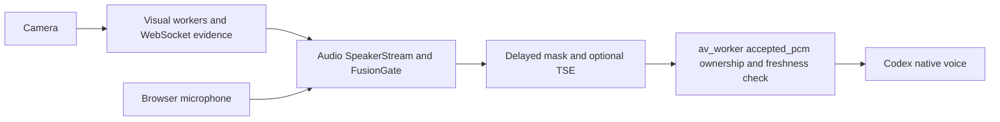

# Upstream exploration: Audio and vision — 2026-10-21

Read GitHub through the connected GitHub tools, inspected pinned source and ran
fixture tests on isolated snapshots. Application checkouts and running services
were left unchanged. There is no CodeGraph index in either application checkout.

## Which code is latest?

| Repository / branch | GitHub tip | Commit time (Vietnam) | Compared with kiosk checkout |
|---|---|---|---|
| Audio / main | `7538d785` | Oct 21, 14:46 | One commit after local `f0f168eb`; local tree clean |
| vision / feat/mouth-activity | `a2289d5e` | Oct 16, 23:10 | Same committed base as local Visual; local patches also exist |
| vision / main | `503402b1` | Sep 21, 20:45 | Older architecture; not the feature branch used by this kiosk |
| vision / fix/camera-selection | `b62ba56e` | Sep 24, 16:13 | Older branch tip; its name does not indicate the newest camera code |

All advertised remote branches were checked. The vision feature branch is
**74 commits ahead of main**, with 144 changed files in the comparison. Also
present: `feat/web-console-body-presence` and `refactor/layered-architecture`.
Sources: [Audio tip](https://github.com/vutiendat323/Audio/commit/7538d7859849cfe3124e49121dea755087fe68d0),
[vision feature tip](https://github.com/vutiendat323/vision/commit/a2289d5eb2e0efba457f6c204293c5bdd6581de1),
[vision comparison](https://github.com/vutiendat323/vision/compare/503402b1a75eb2718ac9378f11f0d7dc2a1d73cd...a2289d5eb2e0efba457f6c204293c5bdd6581de1).

## Architecture and entry points

Audio is a Python ≥3.11 library, not an STT/LLM server. Its core uses NumPy/SciPy;
optional adapters integrate NeMo Sortformer/TitaNet, BSRNN separation and Vision.
Layers follow application → domain ← infrastructure.

| Audio location | Responsibility |
|---|---|
| `application/stream.py:SpeakerStream` | Per-session audio ingestion, diarization, delayed masking and callbacks |
| `domain/fusion.py:FusionGate` | Speaker verdict from identity, face/ASD/mouth evidence and overlap |
| `domain/identity.py:TargetLock` | Customer lock, slot-to-track binding, voiceprint and epoch isolation |
| `infrastructure/vision/asd_bridge.py` | Session-owned 16 kHz PCM mirror, protocol v2 track pins/pushed ASD; v1 fallback |
| `application/console.py` | Settings and monitoring interface for the host console |

Host contract: one stream per session; push raw audio to host VAD first when
applicable; call stream methods on the event-loop thread, keep inline callbacks
short, and call finish before close. The host owns turns, STT, agents and playback.
Source: [SpeakerStream](https://github.com/vutiendat323/Audio/blob/7538d7859849cfe3124e49121dea755087fe68d0/src/audio/application/stream.py).

Vision's feature branch is a layered Python camera service. `main.py` builds
models and injects them into tracking, spoof, presence and active-speaker workers.
The WebSocket server serves the operator console and publishes model evidence.

| Vision location | Responsibility |
|---|---|
| `application/camera_router.py` | Local/remote source selection, normalization, fallback and intrinsics |
| `application/track_faces.py` | SCRFD, ByteTrack/ReID, face PnP distance, mouth/crop updates; reset on source change |
| `application/check_liveness.py` | MiniFASNet spoof observations |
| `application/measure_presence.py` | YOLO body boxes and Metric3D depth on the same frame |
| `application/active_speaker.py` | Light-ASD processing for the selected/pinned face |
| `domain/scene.py`, `application/state.py` | Evidence state, freshness, synchronized frame transfer |
| `presentation/ws_server.py` | Presence/faces/ASD protocol, remote media ownership and console |

The feature branch imports the package as **Visual**, so its directory/package
layout matters. Face distance uses PnP; body distance uses YOLO + Metric3D.
Sources: [composition root](https://github.com/vutiendat323/vision/blob/a2289d5eb2e0efba457f6c204293c5bdd6581de1/main.py),
[presence worker](https://github.com/vutiendat323/vision/blob/a2289d5eb2e0efba457f6c204293c5bdd6581de1/application/measure_presence.py).

Kiosk integration today:

## New Audio fix and its relevance

The newest commit changes only `domain/fusion.py` and its identity regression test.
Previously, two active diarizer slots belonging to the same locked customer counted
as two voices. The gate returned UNCERTAIN/overlap and could send genuine customer
speech through unnecessary separation/masking. The fix counts all TARGET slots as
one voice; non-target slots still contribute to overlap. It changes behavior without
changing the host-facing API or removing identity/evidence checks.

The commit author reports speech attenuation and lost drink names in a live session.
Those live figures were not independently measured in this kiosk. The deterministic
regression **was** reproduced here: the new test on current local Audio returned
UNCERTAIN instead of ACCEPT; the same test passed with the upstream implementation.
Source: [patch and regression](https://github.com/vutiendat323/Audio/commit/7538d7859849cfe3124e49121dea755087fe68d0).

`trendcoffee/av_worker.py` imports the local Audio copy and constructs FusionGate,
SpeakerStream and VisionAudioBridge. Therefore the deployed kiosk has not gained
this fix merely because it exists on GitHub. This is a relevant candidate for the
next integration task; it does not establish a fix for cold native handshakes or
model-to-speech latency.

## Local changes to preserve

Visual has eight modified tracked files and one untracked provenance test. They
include captured-frame timestamps/PAD freshness, source preference/ownership and
camera regression coverage. Inspect those diffs before any synchronization;
replacing Visual with upstream would discard behavior this kiosk depends on.

## Verification and limits

- Audio snapshot reconstructed from the clean local parent plus the two exact
  upstream files; both fetched file contents matched their Git blob hashes.
- Latest Audio: **279 passed in 7.63 s** across domain/application/architecture,
  settings and Vision-bridge tests. NeMo/TitaNet/TSE model-adapter tests were excluded.
- New identity regression against current local Audio: **1 expected failure**,
  proving the behavioral difference; original Audio source was not modified.
- Clean committed Vision feature snapshot: **41 passed in 2.51 s** across camera
  routing, source reset, presence safety, remote video and mouth logic.
- No live models, customer recordings, merchant operations, deployment or restart.
  These selected tests do not establish hardware quality or whole-repository health.

Self-evaluation: accuracy 4/5 (pinned source and regressions verified, hardware not
tested); completeness 4/5 (integration paths covered, full model suites excluded);
clarity 5/5 (branches and local patches separated); actionability 5/5 (exact commit
and integration boundary identified); conciseness 4/5 (branch history adds detail).
Overall 4.4/5. Next improvement: validate the Audio commit through the kiosk Fusion
adapter in a separate integration task, then test actual microphone/ASD behavior.
