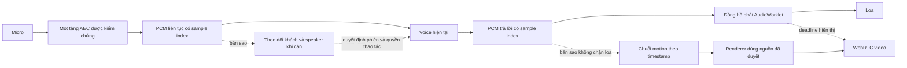

# Phương án cải thiện avatar, audio và độ trễ kiosk

Ngày: 2026-10-30. Mục tiêu: môi/răng gần nhân vật gốc, tiếng thu/phát liền mạch,
ngắt lời nhanh, avatar xử lý local trên RTX 3060 12GB. Giữ dịch vụ voice hiện có.
Đây là kết quả nghiên cứu và rà mã nguồn; các thay đổi dưới đây chưa được áp dụng.
Khi kiểm tra, ba dịch vụ đang dừng; không mở micro hoặc chạy benchmark GPU mới.

## Quyết định đề xuất

Ưu tiên sửa đường đi và đồng hồ media trước. Giữ Ditto làm baseline để so sánh,
không tiếp tục đổi model hoặc thêm model làm đẹp khi chưa tách được nguyên nhân.
Làm theo thứ tự: đo đúng → bỏ audio avatar dư thừa → thử nhánh thu đơn giản hơn
→ sửa chuỗi chuyển động và đồng bộ sample → cải thiện nguồn → đánh giá model riêng.

Không đồng nhất FPS renderer, motion, encoder/RTP và trình duyệt. Không dùng clip
offline 50 bước để kết luận rằng bản streaming 5 bước đã đạt cùng chất lượng.

## Những gì xác định được từ dự án

| Điểm | Bằng chứng trong mã/artifact | Hệ quả và giới hạn kết luận |
|---|---|---|
| Audio vào phải chờ Fusion | `trendcoffee/av_worker.py:70` cấu hình Sortformer, ASD, identity fusion, TSE; `stt_mask_delay_secs=0.7`; `SpeakerStream(... stt_delay_secs=0.7)` tại dòng143 | Có khoảng chờ thiết kế 700ms trên bản mic gửi sang voice. TSE chạy khi cần xử lý overlap, không phải mọi frame đều đi qua suy luận tách tiếng. Chưa đo độ trễ thực của phiên người dùng mới. |
| Có quyết định làm im lặng audio | `Audio/src/audio/application/stream.py` phát bản mic có mask; `trendcoffee/av_worker.py` thêm FusionPreroll; `trendcoffee/kiosk.py:535` bắt buộc Fusion trước voice | Một quyết định speaker/face sai có thể làm mất âm dù micro đã thu được. Đây là cơ chế có thể gây hụt từ, chưa phải chứng minh nguyên nhân của mọi lần hụt. |
| AGC browser đã tắt | `frontend/src/useKioskVoice.ts:344`: AEC true, NS false, AGC false | Bật/tắt lại cùng cờ AGC sẽ không sửa một lỗi đã nằm ở tầng khác. Cần xem settings thực của track và audio stack Linux nếu volume vẫn đổi. |
| Resampler đầu vào rất đơn giản | `frontend/public/voice-capture.js:10` lấy trung bình nhóm mẫu để tạo16kHz; packet80ms | Cần đánh giá thay bằng bộ lọc streaming chống alias. Không thể suy từ code rằng đây là nguyên nhân mất đầu/cuối câu. |
| Avatar có RTP audio nhưng UI bỏ qua | `frontend/src/avatarPlayer.ts:91` nhận chỉ video; dòng125 vẫn xin audio; `scripts/ditto_server.py` vẫn tạo audio track, đổi sang48k, queue và encode | Nhánh audio avatar không phát ra loa kiosk. Có thể bỏ để giảm công việc và liên kết backpressure; voice WebRTC tới Codex vẫn cần giữ. Lợi ích cụ thể phải đo. |
| Nhánh hình có thể xếp hàng12s | `frontend/src/avatarPlayer.ts:172` cho queuedSeconds tới12; pump chờ ack | Đây là mức trần queue, không phải độ trễ thường trực12s. Khi nghẽn, mặt có thể nói theo PCM cũ dù tiếng đã phát. |
| Miệng chỉ đổi tối đa5 lần/giây theo cấu hình hiện tại | `scripts/ditto_realtime.py:21`:3200 mẫu/16kHz=200ms; `_motion()` lấy duy nhất `predicted[:, -1:]` trong chuỗi80frame | Renderer có thể dựng10frame/s nhưng giữ cùng drive giữa các cập nhật. Bỏ qua phần lớn trajectory có thể tạo cảm giác bước/giật. Không thể sửa bằng tăng RTP FPS hoặc lặp frame. |
| Sampler live khác offline | `SAMPLING_STEPS=5`; offline review dùng50 | Cần đánh giá trực tiếp5/10/20/50 bước cùng nguồn/audio. Tăng bước không bảo đảm giữ đúng răng và làm tăng chi phí. |
| Chưa có timestamp audio chung với hình | VoicePlayer phát PCM qua AudioWorklet; avatar có sample count nội bộ và RTP clock riêng; packet avatar chưa mang vị trí phát của loa | FPS và HTTP reset nhanh chưa chứng minh lip-sync hoặc ngắt tiếng ở loa. Cần một quan hệ rõ giữa PCM sample index, đồng hồ trình duyệt và pose. |
| Chuyển clip dựa vào khoảng trống packet | Engine dùng `now-last_push<0.3` làm dấu hiệu đang nói, rồi chọn clip đứng chờ/nói/vẫy tay khác nhau | Nếu packet thực sự ngừng hơn300ms giữa một lượt nói, có thể chuyển clip dù chưa kết thúc câu. Cần dùng ranh giới turn và căn pha/tư thế của nguồn; không kết luận hiện tượng này xảy ra ở mọi khoảng nghỉ. |
| Vùng miệng nguồn nhỏ | `output/avatar-quality-review/mouth-detail-probe/source-landmarks.npy`: median span landmark mặt153×159px; miệng63×33px | Đây là span các landmark, không phải toàn bộ bounding box mặt. Nguồn720p toàn thân không tương đương mặt có độ chi tiết720p. Đây là phép đọc artifact CPU của nguồn cũ, không đo phiên live. |

Các số đo đã có: renderer interface14.38FPS; synthetic production RTP12FPS,
79 face renders trong khoảng8.04s speech; motion23ms/update, face render76ms,
PCM ack P952.62ms, reset HTTP1.26ms. Nguồn:
`output/ditto-webrtc-production/acceptance.json` và
`output/avatar-quality-review/ditto-torch-benchmark/verified-renderer.json`.
Không có số đo acoustic mới trong nghiên cứu này. Không cộng tất cả các buffer
thành một con số trễ: nhiều bước chạy chồng nhau và cần timestamp để phân biệt.

## Kiến trúc nên hướng tới

Đây là kiến trúc đề xuất. Việc cho owner/speaker chạy song song thay vì mask PCM
có đánh đổi thật về nghe nhầm người xung quanh; không tự động an toàn như bản
lọc hiện tại. Quyền đặt hàng và quy tắc chọn khách cần được giữ và kiểm tra riêng.

## Nên cắt hoặc chuyển thành tùy chọn

### 1. Bỏ RTP audio của riêng avatar

Chuyển SDP avatar sang video-only. Giữ PCM WebSocket làm đầu vào cho lip-sync.
Không bỏ WebRTC voice đang phục vụ Codex và không thay VoicePlayer phát loa.

Cần sửa đồng bộ `AvatarPlayer`, `DittoTransport`, phép chuyển PCM và các smoke
tests: hiện queue48k được audio track drain và dùng cho backpressure. Nếu chỉ bỏ
transceiver ở frontend mà để queue này, PCM sẽ bị nghẽn. Bản sửa phải bỏ queue đó
trong video-only session, chỉ backpressure theo buffer model có giới hạn; giữ
epoch/reset, single-peer và timeout. Smoke test mới đo video-only và kiểm audio
qua đường native, không đòi audible RTP của avatar nữa.

### 2. Tách Fusion nặng khỏi đường voice mặc định trong một thử nghiệm có kiểm soát

So sánh hai chế độ trên cùng đoạn nói: bản Fusion hiện tại và đường PCM sạch với
mic gần/khách đã được chọn. Đường đơn giản giữ AEC và lịch media, không chặt PCM
theo từng verdict ASD/diarization. Cho Sortformer/TitaNet/TSE chạy khi ca sử dụng
thực sự cần phân biệt nhiều người/overlap, thay vì luôn là điều kiện để mic tới voice.

Chỉ chuyển mặc định khi thử được cả nền có người nói khác và lúc khách nói chen
trên tiếng avatar. Nếu cần tách người liên tục ở quán đông, không thể hứa giảm hết
trễ mà vẫn giữ cùng khả năng lọc; cần đánh giá phương án mic định hướng hoặc
chế độ bấm-nói. Không tự bỏ owner lock hoặc quyền thao tác chỉ để đạt số latency.

### 3. Loại xử lý audio trùng, giữ đúng một tầng cần thiết

Browser đang AEC=true, AGC=false, NS=false. Đọc `getSettings()`/`getCapabilities()`
để biết thực tế thiết bị thực thi gì; kiểm tra có virtual echo-cancel source ở
PipeWire hay không. Nếu OS và browser cùng xử lý AEC, thử A/B chọn một tầng hoạt
động tốt với chính đường loa hiện tại. Không tắt AEC mặc định khi dùng loa ngoài:
AEC giúp nói chen không bị nhận lại tiếng của avatar. [W3C Capture](https://www.w3.org/TR/mediacapture-streams/),
[WebRTC APM](https://webrtc.googlesource.com/src/+/refs/heads/main/modules/audio_processing/g3doc/audio_processing_module.md),
[PipeWire Echo Cancel](https://docs.pipewire.org/page_module_echo_cancel.html).

Giữ resampler có trạng thái và playback trên AudioWorklet. Thử resampler FIR/
polyphase thay box-average đầu vào; nếu fast path giữ48k tới voice thì chỉ giảm
xuống16k ở bản sao cho model cần16k. Phải sửa định dạng giao thức/NativePeer
cùng lúc, vì đường hiện tại mặc định packet80ms/16k; không đổi sampleRate trong
header mà giữ nguyên bytes. Chưa có kết quả chứng minh thay resampler sẽ sửa hụt từ.

Không giảm buffer phát160–200ms xuống0 để làm đẹp số độ trễ; buffer này đang che
jitter đã quan sát. Tách underrun của PCM khỏi trạng thái assistant turn: một
khoảng buffer thiếu ngắn không nên tự biến thành kết thúc câu. Các thay đổi cần
test âm nhỏ, khoảng nghỉ dài, và lần bắt đầu/kết thúc thật.

### 4. Bỏ cách giữ một pose rồi nhảy sau200ms

Thiết kế lại motion stream để phát một chuỗi pose theo sample timestamp và dùng
quy tắc overlap/fusion của predictor, thay vì chỉ giữ phần tử cuối của80frame.
Nội suy trong motion space giữa các pose hợp lệ có thể làm mượt; đó không phải
phoneme mới và không thay được predictor sai hoặc thiếu dữ liệu.

Gắn `epoch + audio_sample_index + source_clip/frame + pose_time` cho dữ liệu
và đo clock drift. Hiển thị pose theo thời điểm PCM thực ra loa; dùng
`AudioContext.getOutputTimestamp()` khi browser hỗ trợ. Chỉ số này là ước lượng
đồng hồ thiết bị, không thay phép đo acoustic. RTP có thể dùng `getStats()` để
đo jitter/frames nhưng native PCM ở AudioWorklet không tự đồng bộ với video của
một PeerConnection khác. [Web Audio timestamp](https://www.w3.org/TR/webaudio/#dom-audiocontext-getoutputtimestamp),
[WebRTC stats](https://www.w3.org/TR/webrtc-stats/#dom-rtcinboundrtpstreamstats-jitterbufferdelay).

Khi video trễ: bỏ pose/frame video quá hạn theo timestamp, không bỏ từ/audio.
Không replay queue hình cũ sau giật mạng. Giữ nguyên reset epoch để loại kết quả
GPU của lượt cũ. Cần giới hạn queue theo tuổi dữ liệu, không chỉ số phần tử/12s.
Giữ semantic turn state qua khoảng nghỉ trong câu. Đừng để underrun ngắn hoặc
timeout packet tự chuyển đứng chờ/nói nhiều lần; dùng sự kiện kết thúc/ngắt lời
rõ ràng, đồng thời xử lý timeout mất kết nối riêng. Khi đổi clip cần căn tư thế
và màu; cross-fade hai khuôn miệng lệch nhau cũng có thể tạo hình ma/bóng đôi.

### 5. Giảm phần ảnh bị tổng hợp và cải thiện nguồn

Nguồn mới nên quay/cung cấp cận mặt, rõ răng/môi ở độ phân giải gốc, cùng nhân
vật, cùng ánh sáng, màu, camera và tư thế. Một clip toàn thân1080p vẫn có thể có
quá ít pixel miệng. Không dùng loop để giả video huấn luyện dài hơn: không thêm
trạng thái phát âm hoặc chi tiết răng. Cần kiểm tra tính nhất quán răng của video
AI gốc trước khi huấn luyện một model theo nhân vật.

Ditto hiện đã render vùng mặt rồi ghép vào body gốc; không phải diffusion sinh
lại toàn thân. Có thể thử phát idle/body/wave gốc tại client bằng video decoder,
chỉ stream vùng mặt/miệng cần thay đổi. Cách này giảm encode/composite không
cần thiết và giữ body mượt theo clip nguồn; không tự sửa anatomy của miệng.
Compositing cần cùng clip timestamp, căn jaw/mask/ánh sáng, chống seams và thử
chuyển clip. Đây là nhánh prototype, không phải tối ưu đã đo.

Không thêm GFPGAN/CodeFormer, face swap hoặc frame interpolation ảnh vào hot path
để che lỗi môi/răng. Chúng không có bảo đảm giữ anatomy và có thể thêm chi phí,
temporal artifacts. Các helper phục hồi ảnh trước đây không được nối vào Ditto
đang chọn, nên xóa chúng khỏi ổ đĩa sẽ không làm runtime hiện tại nhanh hơn.

## Chọn stack

Giữ **Ditto/PyTorch đã tối ưu + VoicePlayer/AudioWorklet + WebRTC video-only** làm
nhánh thực dụng đầu tiên, sau khi thực hiện và kiểm chứng các thay đổi ở trên.
Không coi thay Ditto bằng “LivePortrait + audio” là tự động đổi cách render:
Ditto đã dùng cùng nhóm appearance-feature warping/neural decode. [Ditto](https://github.com/antgroup/ditto-talkinghead).

Nếu vẫn không giữ được diện mạo môi/răng, đánh giá model theo nhân vật (2D/NeRF/
3DGS) với dữ liệu phù hợp. **InsTaG** là nhánh nghiên cứu đáng thử vì có recipe
adaptation ngắn, nhưng cần kiểm tra quyền sử dụng, chất lượng nguồn, tiếng Việt
và tốc độ trên chính3060. Đây không phải khuyến nghị thay production ngay.
Chi tiết so sánh12 nhóm model, GPU, dữ liệu và license nằm trong
[báo cáo nguồn chính chủ](realtime-avatar-stack-sources.md).

Không có nguồn đã kiểm tra nào bảo đảm đồng thời miệng/răng giống hệt video gốc,
zero-latency và25FPS trên3060 cho mọi câu mới. Mục tiêu là kiểm chứng một cấu hình
cụ thể với bộ câu và video đã duyệt, không suy số4090/A100 ra kết quả máy này.

## Thứ tự triển khai và tiêu chí nghiệm thu đề xuất

Các ngưỡng dưới đây là mục tiêu dự án để thử, chưa phải kết quả đạt được:

| Giai đoạn | Việc làm | Cách quyết định |
|---|---|---|
| P0 — đo | Mốc capture→sauFusion→native input; native output→AudioWorklet→ước lượng ra loa; pose/audio sample→video display | Cùng clock hoặc mapping rõ. HTTP1ms chỉ đo control-plane; không dùng thay âm thanh đã dừng ở loa. |
| P1 — giảm thừa | Video-only avatar, bỏ queue/RTP audio của avatar; fast-voice profile A/B | Không tăng underrun, mất âm đầu/cuối hoặc sai guest; kiểm foreground/background và barge-in. Chưa suy tính700ms thành mức tiết kiệm chắc chắn. |
| P2 — thời gian | Timestamp chung, giữ trajectory, chống pose nhảy; loại queue hình quá hạn | Mục tiêu P95 audio-video skew≤100ms; audio mới không chờ GPU; không tăng latency theo phiên10phút. |
| P3 — nguồn/mô hình | Bộ cận mặt chuẩn; live sampler5/10/20/50 bước so sánh cùng audio; model riêng nếu cần | Người dùng duyệt môi/răng, không nhấp nháy/răng thay cấu trúc; FPS tăng không thay phán xét chất lượng. |

Test hai câu từng hụt từ: “chào bạn tôi cần bạn giúp đỡ”, “cho tôi xem menu đi”.
Mỗi câu20lần khi avatar im và20lần khi nói chen; đối chiếu raw/sau-gate ở cấp sample
và transcript để biết mất âm ở đâu. Nếu ghi âm để so sánh, dùng fixture có kiểm soát
hoặc chính câu thử được phép lưu, không tự ghi phiên khách. Thử thêm lời nói≥30s,
khoảng nghỉ, âm nhỏ, mất kết nối, đổi khách và ngắt lời giữa GPU inference.

Đo separate neural FPS, pose-update FPS và display FPS; đếm frame lặp. Kiểm chứng
với camera/Fusion bật và tắt để thấy tranh GPU, không chỉ benchmark decoder đơn lẻ.
Kiểm P95/P99 và waveform underrun/clipping; không dựa duy nhất vào trung bình.

## Tự đánh giá

Accuracy4/5: code/artifact cụ thể và nguồn chính chủ; chưa đo mic/acoustic mới.
Completeness4/5: quyết định stack, thành phần cần cắt, dữ liệu và nghiệm thu; chưa
áp dụng thay đổi pipeline. Clarity4/5: tách kết luận đã xác minh với giả thuyết và
mục tiêu. Actionability4/5: có thứ tự sửa và file liên quan; nhánh ít Fusion cần
kiểm yêu cầu nhiều người. Conciseness4/5: chi tiết để ở báo cáo, kết luận đưa trước.
Trung bình4.0/5. Ưu tiên tiếp là instrumentation và thí nghiệm video-only/fast voice,
không thêm một model nặng khác trước khi có bằng chứng.
