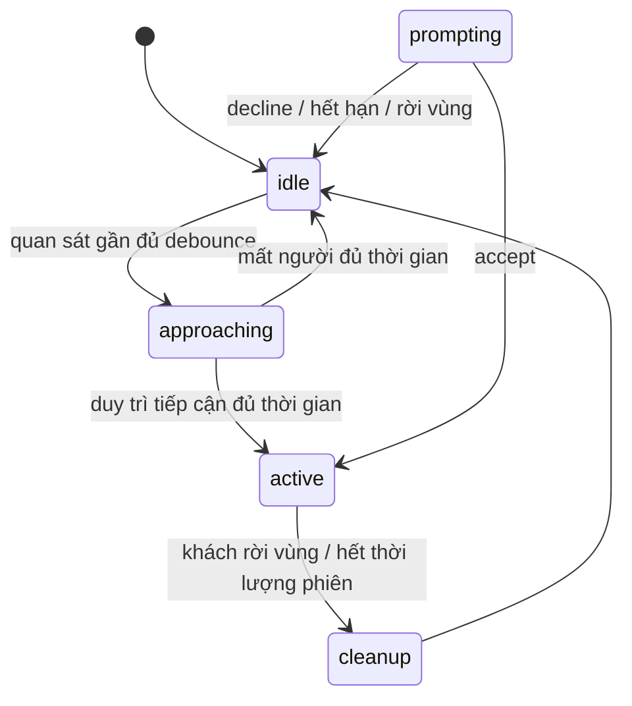
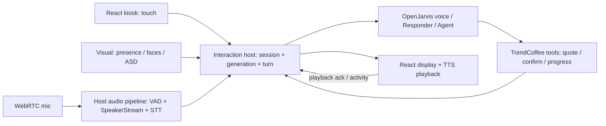

# OpenJarvis: state, ranh giới phiên và thời gian cho Kiosk + Audio + Visual

Khảo sát ngày 2026-10-17. Nguồn chính là mã hiện có trong `../jarvis/OpenJarvis` và các bản sao `Audio/`, `Visual/` ở repository này. Đã dùng CodeGraph trước khi đọc OpenJarvis, kiểm tra preset bằng các trường được chọn, chạy một nhóm kiểm thử giới hạn và một mô phỏng thuần. Không thay đổi ứng dụng, cấu hình, model hoặc ngưỡng; không khởi động/restart stack, camera hay microphone. Root `AGENTS.md` giữ nguyên.

## Kết luận và trạng thái tích hợp

**OpenJarvis đã có orchestration cho kiosk/voice và adapter cho Audio; OpenAIMK hiện có giao diện đặt món và backend nghiệp vụ, chưa nối Audio/Visual.** Bản sao thư mục không tự tạo thành tích hợp. Nên tận dụng luồng voice đã có, nối qua adapter với backend giá/quote/order hiện tại và đưa vòng đời khách về một authority chung.

Bằng chứng: [speaker-engine selector](/home/metek/Projects/jarvis/OpenJarvis/src/openjarvis/server/voice/pipeline.py:198) chọn `AudioSpeakerProcessor` khi `speaker.engine == "audio"`, [adapter](/home/metek/Projects/jarvis/OpenJarvis/src/openjarvis/server/voice/speaker_engine_audio.py:110) tạo `SpeakerStream`. Preset `ordering-kiosk-mcp.toml` chọn `audio`; kiểm tra import trong môi trường OpenJarvis trả về `/home/metek/Projects/jarvis/Audio/src/audio/__init__.py`, không phải bản sao ở OpenAIMK. Nếu import/build Audio thất bại, adapter có fallback về engine OpenJarvis; cấu hình chọn Audio chưa chứng minh runtime đang dùng nó. [Import fallback](/home/metek/Projects/jarvis/OpenJarvis/src/openjarvis/server/voice/speaker_engine_audio.py:64), [build fallback](/home/metek/Projects/jarvis/OpenJarvis/src/openjarvis/server/voice/speaker_engine_audio.py:209).

## Các lớp state cần phân biệt

| Lớp | State / owner thực tế | Ý nghĩa |
|---|---|---|
| Kiosk tương tác | `idle`, `approaching`, `prompting`, `active`, `cleanup`; một coroutine `kiosk_main` | Quyết định một khách có đang được phục vụ và mic có được phép hoạt động. [FSM](/home/metek/Projects/jarvis/OpenJarvis/src/openjarvis/kiosk/evaluate.py:17), [owner](/home/metek/Projects/jarvis/OpenJarvis/src/openjarvis/kiosk/runtime.py:37). |
| Voice session | `connecting`, `listening`, `busy`, `ended`; `VoiceSessionService` và một local lease | Gắn voice với chat thread, từ chối kết nối voice thứ hai khi lease còn giữ. `busy` cũng là kết quả từ chối lease. [Session/lease](/home/metek/Projects/jarvis/OpenJarvis/src/openjarvis/server/voice/session.py:63). |
| Nhận diện người nói | `NONE → PRE_LOCK → LOCKED`; `TargetLock` trong Audio | Giữ đúng người nói qua evidence Audio/Visual. `track_id` là ID theo dõi cảm biến, không phải danh tính khách hoặc quyền thanh toán. [Lock](/home/metek/Projects/OpenAIMK/Audio/src/audio/domain/identity.py:192). |
| Turn và phát tiếng | VAD/Smart Turn, `active_turn_id`, cancellation epoch, bot started/stopped, playback boundary | Phân biệt khách ngừng nói, model trả xong và loa phát xong; chỉ một trong ba không thể đại diện cả ba. [Turn epoch](/home/metek/Projects/jarvis/OpenJarvis/src/openjarvis/server/voice/session.py:160), [playback](/home/metek/Projects/jarvis/OpenJarvis/src/openjarvis/server/voice/lifecycle.py:107). |
| Nghiệp vụ Trend Coffee | Capability guest, giỏ/revision, quote, order/payment; `trendcoffee.Service` | Giá do server kiểm tra; xác nhận mới lưu yêu cầu, và trạng thái thanh toán riêng. [Giỏ](/home/metek/Projects/OpenAIMK/frontend/src/state.ts:3), [giá](/home/metek/Projects/OpenAIMK/trendcoffee/service.py:168), [submit](/home/metek/Projects/OpenAIMK/trendcoffee/service.py:236). |

Session hội thoại Codex đã khảo sát trước đó phục vụ công việc phát triển; không dùng UUID đó làm phiên khách tại kiosk.

Luồng vào mặc định trong mã hiện tại:



`prompting` tồn tại nhưng đường `approaching` hiện gọi thẳng `_activate_session()`, không tự đi qua popup consent. Nếu sản phẩm yêu cầu xác nhận trước khi mở mic, cần thiết kế nhánh đó rõ ràng; không suy ra từ việc đã có state tên `prompting`. [Auto-activation](/home/metek/Projects/jarvis/OpenJarvis/src/openjarvis/kiosk/evaluate.py:131).

## Ranh giới thời gian: mặc định, preset và hệ thống hiện tại

Các giá trị dưới đây là mã/preset đọc được, **chưa chứng minh tiến trình đang chạy đã nạp đúng preset hoặc các điều chỉnh live của operator**.

| Ranh giới | Mặc định trong code | Preset ordering-kiosk được kiểm tra | Tính từ đâu |
|---|---:|---:|---|
| Vùng tiếp cận | 1,0 m | 0,6 m | Khoảng cách người được theo dõi |
| Debounce vào approaching | 0,4 s | 3 s | Chuỗi quan sát gần |
| Cho vào active | 5 s | 5 s | Tổng chuỗi quan sát gần; không cộng thêm debounce thành 8 s |
| Rời vùng khi active | 10 s | 3 s | Khoảng vắng liên tục của khách đang sở hữu phiên |
| Cảnh báo / giới hạn phiên | 540 / 600 s | 540 / 600 s | Thời lượng tuyệt đối từ lúc active; không phải idle timeout |
| Prompt timeout / decline cooldown | 30 / 10 s | 30 / 10 s | Bắt đầu prompting / lúc decline; chỉ liên quan khi đi qua prompting |

Nguồn: [KioskConfig](/home/metek/Projects/jarvis/OpenJarvis/src/openjarvis/kiosk/config.py:17), [preset](/home/metek/Projects/jarvis/OpenJarvis/configs/openjarvis/examples/ordering-kiosk-mcp.toml), [operator override](/home/metek/Projects/jarvis/OpenJarvis/src/openjarvis/kiosk/operator_config.py:68). Giá trị cảnh báo được loader tính bằng `session_max_seconds - 60`. Voice lifecycle dùng lại các ngưỡng này, nhưng timer riêng bắt đầu khi WebRTC client kết nối; FSM bắt đầu đếm lúc active. Hai mốc có thể lệch nhau. [Voice wiring](/home/metek/Projects/jarvis/OpenJarvis/src/openjarvis/server/voice/pipeline.py:325). Cảnh báo có guard phát một lần; không kết luận hai timer luôn tạo hai câu cảnh báo. [Guard](/home/metek/Projects/jarvis/OpenJarvis/src/openjarvis/server/voice/lifecycle.py:191).

| Ranh giới khác | Giá trị / hành vi hiện có | Phân biệt cần giữ |
|---|---|---|
| FSM tick / presence / faces | Tick chờ tối đa 0,2 s; presence 5 Hz, faces 10 Hz | Nhịp vòng lặp không phải SLA trễ tối đa; effects/inference có thể làm chậm. [Runtime](/home/metek/Projects/jarvis/OpenJarvis/src/openjarvis/kiosk/runtime.py:82), [Vision](/home/metek/Projects/OpenAIMK/Visual/presentation/ws_server.py:71). |
| VAD / semantic end-of-turn | VAD stop 0,2 s; Smart Turn cần im lặng tối thiểu 1,5 s, fallback 3 s | VAD báo ngừng audio sớm để STT finalize; chưa đủ để xác nhận khách đã nói xong ý. [Pipeline](/home/metek/Projects/jarvis/OpenJarvis/src/openjarvis/server/voice/pipeline.py:40). |
| STT finalize / transcript guard | Hold 0,6 s; drain có timeout 1 s; Gemini TTFS guard cấu hình 1,6 s | Những cửa sổ có thể chồng nhau; không cộng máy móc thành latency hoặc coi là P99 đo mới. [Finalize](/home/metek/Projects/jarvis/OpenJarvis/src/openjarvis/server/voice/transcription.py:35), [guard](/home/metek/Projects/jarvis/OpenJarvis/src/openjarvis/server/voice/routes.py:223). |
| Responder decision | 2 s | Hết hạn thì Agent bắt đầu; filler đến muộn chỉ còn được dùng trước text Agent đầu tiên. Không bảo đảm loa bắt đầu nói trong 2 s. [LLM flow](/home/metek/Projects/jarvis/OpenJarvis/src/openjarvis/server/voice/llm.py:643), [báo cáo lịch sử](/home/metek/Projects/jarvis/OpenJarvis/docs/verification/2026-10-15-responder-timeout-recovery/report.md). Giữ lựa chọn DeepSeek Responder hiện có. |
| Im lặng trong voice | Nudge sau 15 s khi thích hợp | Gợi ý một lần, không phải tự kết thúc phiên ở giây thứ 15. [Lifecycle](/home/metek/Projects/jarvis/OpenJarvis/src/openjarvis/server/voice/lifecycle.py:164). |
| Voice lease stale | 300 s từ last_activity theo mặc định | Reclamation được gọi khi kiểm tra stale; không phải hard limit 5 phút cho mọi voice session. [Session](/home/metek/Projects/jarvis/OpenJarvis/src/openjarvis/server/voice/session.py:232). |
| Kết thúc / goodbye | Chờ pipeline tối đa 30 s trước cancel | Xếp TTS goodbye rồi đợi task kết thúc; speech-frame không tự chứng minh người dùng nghe thấy. [Shutdown seam](/home/metek/Projects/jarvis/OpenJarvis/src/openjarvis/server/voice/pipeline.py:12). |
| OpenAIMK frontend idle | Cảnh báo 90 s, reset 120 s | Hiện chỉ pointerdown/keydown/wheel làm mới activity; chưa có speech/playback activity. [UI](/home/metek/Projects/OpenAIMK/frontend/src/App.tsx:137). |
| OpenAIMK nghiệp vụ | HTTP timeout 8 s; quote 5 phút; working draft 15 phút; menu 24 giờ; guest capability tối đa 30 ngày | Timeout trình duyệt không chứng minh server chưa lưu yêu cầu. Capability dài hạn không xác định khách vật lý vẫn đứng trước máy. [HTTP](/home/metek/Projects/OpenAIMK/frontend/src/api.ts:25), [quote](/home/metek/Projects/OpenAIMK/trendcoffee/service.py:228), [draft](/home/metek/Projects/OpenAIMK/trendcoffee/service.py:396), [guest](/home/metek/Projects/OpenAIMK/trendcoffee/service.py:67). |

## Các điểm cần xử lý trước khi nối

1. **Hai authority kết thúc phiên sẽ xung đột.** Nếu giữ nguyên idle timer UI hiện tại, khách chỉ dùng giọng nói vẫn có thể bị reset sau 120 s dù đang nói. Cần activity chung cho touch, speech được chấp nhận và playback, cùng một policy idle/absolute limit. Đây là kết luận tích hợp từ code, chưa chạy live voice trên OpenAIMK.
2. **Presence cũ có thể kích hoạt/giữ phiên.** Mô phỏng thuần trên OpenJarvis: một event gần `ts=100`; không gửi event khác; evaluate `idle` ở `106` trả `approaching`, evaluate tiếp trả `active`; evaluate active ở `130` vẫn active. `consecutive_kind_duration` dùng `now - run_start`; `last_event` không kiểm tuổi; reconnect không phát marker unavailable. [History](/home/metek/Projects/jarvis/OpenJarvis/src/openjarvis/kiosk/events.py:62), [VisionClient](/home/metek/Projects/jarvis/OpenJarvis/src/openjarvis/kiosk/vision_client.py:73). Visual còn có rủi ro emit timestamp mới cho frame cũ, nêu trong appendix. Cần freshness từ capture và trạng thái sensor-stale riêng; chỉ kiểm WS vừa nhận chưa đủ.
3. **Một phiên phải có generation xuyên suốt.** OpenJarvis đã có voice turn epoch, presentation generation và owner track; OpenAIMK có generation/revision guard cho quote. Cần nối các ID này thay vì tạo ba bộ reset độc lập. Khi đổi khách, chặn callback cũ trước khi dọn buffers/transport; hủy tác vụ không tự hoàn tác đơn đã commit. [Presentation guard/reset](/home/metek/Projects/jarvis/OpenJarvis/src/openjarvis/kiosk/presentation.py:527), [owner track](/home/metek/Projects/jarvis/OpenJarvis/src/openjarvis/kiosk/runtime.py:229), [UI reset](/home/metek/Projects/OpenAIMK/frontend/src/App.tsx:113).
4. **Speaker verdict không phải quyền giao dịch.** Audio có fallback ACCEPT khi không đếm được frame, và tool allowlist là hợp đồng host phải enforce. Phải đi qua server quote, xác nhận và capability của đúng khách; Audio/Visual không tự xác nhận thanh toán. [Verdict](/home/metek/Projects/OpenAIMK/Audio/src/audio/domain/verdict.py:17).
5. **Bản sao môi trường vẫn trỏ về repo gốc.** `.venv` trong Audio/Visual không portable; chưa dùng chúng làm runtime ở OpenAIMK. Cần môi trường được tạo/cài có chủ đích trước integration test. Bằng chứng và các giới hạn queue/timeout nằm ở appendix.

## Đề xuất nối module — chưa triển khai



- **Một chủ phiên cho mỗi kiosk.** Host server cấp interaction ID/generation, liên kết capability nghiệp vụ; voice lease và sensor stream phải thuộc phiên đó. Khi sensor lỗi, giữ được đường touch và báo trạng thái không khả dụng thay vì lấy evidence cũ làm hiện diện.
- **Hai adapter có lý do rõ ràng:** adapter Audio/Visual tái dùng luồng OpenJarvis; adapter nghiệp vụ bọc `trendcoffee.Service`/MCP hiện có. Giữ React UI và quy tắc giá/đơn của TrendCoffee; camera chỉ cung cấp evidence cho interaction host.
- **Envelope sự kiện đề xuất:** `device_id`, `session_id`, `generation`, `turn_id` khi có, `stream_id`, `seq`, `observed_at` và `received_monotonic`. Cả backend lẫn browser từ chối generation cũ. Lưu wall clock cho audit; dùng monotonic/deadline cho khoảng chờ trong process, sample index cho audio; không so trực tiếp monotonic clock của hai máy.
- **Shutdown có thứ tự:** đánh dấu phiên kết thúc/invalidate generation → ngừng nhận utterance mới → hủy pending turn/stop playback → flush hoặc discard tail theo lý do dừng → đóng voice/ASD/video lease, xóa speaker/face/voiceprint/buffers → reset hiển thị → cấp phiên khách mới. Hard privacy reset có thể bỏ goodbye thay vì chờ tối đa 30 s. Đơn đã lưu giữ trạng thái nghiệp vụ và operation ID; reset màn hình không hủy đơn.
- **Latency đo theo pipeline:** `speech_stop → transcript_final → first_agent_text → tts_first_chunk → playback_started`. Đặt budget riêng từng chặng sau baseline; không đổi các ngưỡng speech/TSE chỉ để đạt con số UI. Biện pháp cụ thể cần kiểm chứng trước: capture freshness, queue cap/drop policy, teardown và chặn stale callbacks.
- **Thứ tự triển khai đề xuất:** (1) session authority/event contract + mô phỏng; (2) Visual presence/freshness và touch fallback; (3) Audio/WebRTC với fake STT/TTS để kiểm turn/reset; (4) model thật, speaker/ASD và phép đo latency; (5) nối tools nghiệp vụ, xác nhận và progress. Mỗi bước có acceptance riêng; không cần nhập toàn bộ OpenJarvis vào repository hiện tại.

## Kiểm chứng đã thực hiện và giới hạn

Đã chạy trong môi trường OpenJarvis:

```bash
timeout 60 .venv/bin/python -m pytest \
  tests/kiosk/test_session_owner.py \
  tests/kiosk/test_leave_detection.py \
  tests/kiosk/test_vision_client.py \
  tests/server/test_voice_lifecycle.py \
  tests/server/test_voice_boundaries.py \
  -q --tb=short -m 'not live and not cloud and not hub'
```

**48 passed trong 13,64 s**, hai cảnh báo dependency hiện có. Nhóm test này dùng các fixture/mock cho lifecycle/ownership, không xác nhận speaker accuracy, camera thật hay latency end-to-end. Mô phỏng presence cũ thực hiện bằng `EventHistory`, `VisionEvent`, `evaluate_state` với timestamp cố định; không sửa source. Các số 98/248/539 và model latency trong báo cáo OpenJarvis cũ chỉ là bằng chứng lịch sử, không phải suite chạy lại trong khảo sát này.

## Appendix: detailed Audio/Visual source evidence

Các phần dưới đây là đọc mã của các bản sao; không chạy môi trường đã copy, không chạy parity tool hoặc real-model Audio/Visual integration.

## Audio: actual API and ownership


`Audio` is a Python library with numpy/scipy as core dependencies and optional NeMo/torch, WebSocket, and TOML extras. It does not supply a server or browser transport. Its architecture deliberately leaves VAD, STT, conversation turns and the agent to a host. The public plumbing is `SpeakerStream`, `AudioChunk`, `SpeakerVerdict`, and `SttAudio`; the last carries masked PCM plus the verdict and masking reason. Sources: [package dependencies](/home/metek/Projects/OpenAIMK/Audio/pyproject.toml:1), [host contract](/home/metek/Projects/OpenAIMK/Audio/src/audio/application/stream.py:1), [frame types](/home/metek/Projects/OpenAIMK/Audio/src/audio/application/stream.py:60).

| Host obligation | Existing Audio behavior and evidence |
|---|---|
| Create one stream per voice session | `start()` once; a second start raises. No session ID is attached to verdict/STT callbacks. New session ownership must come from the object/callback closure. [start](/home/metek/Projects/OpenAIMK/Audio/src/audio/application/stream.py:297), [output types](/home/metek/Projects/OpenAIMK/Audio/src/audio/application/stream.py:73). |
| Call from the event-loop thread | Mic callback threads must use `loop.call_soon_threadsafe`; raw mic goes to host VAD before `push_audio`. [contract](/home/metek/Projects/OpenAIMK/Audio/src/audio/application/stream.py:8). |
| Supply canonical mic format | Diarization accepts PCM16, 16 kHz, mono; unsupported formats are warned once and skipped. The stream does not resample input. [enqueue](/home/metek/Projects/OpenAIMK/Audio/src/audio/application/stream.py:378). |
| Handle actual playback events | `bot_started()` marks playback indefinitely audible; `bot_stopped()` keeps a 300 ms reverb tail, measured with monotonic time. [playback hooks](/home/metek/Projects/OpenAIMK/Audio/src/audio/application/stream.py:314), [tail constant](/home/metek/Projects/OpenAIMK/Audio/src/audio/application/stream.py:103). |
| Finalize STT at the right boundary | `drain()` releases due STT audio and flushes held overlap with separation before host STT finalization. `finish()` flushes all delayed audio without a new separation GPU call. `close()` alone drops the tail. [drain](/home/metek/Projects/OpenAIMK/Audio/src/audio/application/stream.py:877), [finish/close](/home/metek/Projects/OpenAIMK/Audio/src/audio/application/stream.py:346). |
| Keep output callbacks short | Both callbacks are awaited inline; exceptions are logged and swallowed. A slow callback consumes processing capacity rather than applying controlled host backpressure. [callbacks](/home/metek/Projects/OpenAIMK/Audio/src/audio/application/stream.py:355). |
| Serialize shared models | Default diarizer/separator/embedder executors each have one thread. External shared models must use compatible serial executors. [stream contract and pools](/home/metek/Projects/OpenAIMK/Audio/src/audio/application/stream.py:20), [embedding pool](/home/metek/Projects/OpenAIMK/Audio/src/audio/application/embedding.py:23). |

Defaults do not enable speaker processing: `enabled`, `vision_faces`, `vision_asd`, `stt_mask` are false and `identity`, `diarizer`, `separator` are `none`. Validation enforces ASD dependencies, caps ASD wait at 120 ms and requires at least 700 ms masking delay when both ASD and masking are enabled. The nominal 500 ms mask-delay default therefore cannot simply be combined with ASD. [defaults](/home/metek/Projects/OpenAIMK/Audio/src/audio/domain/settings.py:11), [validation](/home/metek/Projects/OpenAIMK/Audio/src/audio/domain/settings.py:119).

### Audio lock and turn boundaries

The fusion gate receives `fsm_state: Callable[[], str]` from the host. Every diarizer row invokes that callback and feeds `TargetLock.observe_fsm`. Only the exact state `active` permits `NONE → PRE_LOCK`; visual/audio confirmation can then lock a customer. Leaving `active` clears the lock, voiceprint, slot associations and pending evidence, and increments an epoch. This happens when a row is processed, not immediately when an external FSM changes. [fusion entry](/home/metek/Projects/OpenAIMK/Audio/src/audio/domain/fusion.py:25), [row FSM observation](/home/metek/Projects/OpenAIMK/Audio/src/audio/domain/fusion.py:61), [lock reset](/home/metek/Projects/OpenAIMK/Audio/src/audio/domain/identity.py:232).

The lock stays assigned to its customer even if another face moves nearer; disappearance for more than 500 ms releases the ASD pin, not the customer lock. On epoch change, stream bookkeeping clears pending embedding segments and TSE enrollment. Embedding results carry an epoch and segment end; stale results are rejected. These are useful existing protections but are limited to speaker identity, not business requests or browser state. [lock semantics](/home/metek/Projects/OpenAIMK/Audio/src/audio/domain/identity.py:192), [absence/pin](/home/metek/Projects/OpenAIMK/Audio/src/audio/domain/identity.py:353), [embedding checks](/home/metek/Projects/OpenAIMK/Audio/src/audio/domain/identity.py:364), [stream epoch handling](/home/metek/Projects/OpenAIMK/Audio/src/audio/application/stream.py:689).

`turn_verdict` folds frame counts but owns no utterance start/end, transcript, or tool authorization. It returns ACCEPT when there are no counted frames. Hosts must choose explicitly whether this permissive fallback is appropriate for voice-triggered mutations. `uncertain_allowed_tools` is a setting, not enforcement by `SpeakerStream`. [turn verdict](/home/metek/Projects/OpenAIMK/Audio/src/audio/domain/verdict.py:17), [setting](/home/metek/Projects/OpenAIMK/Audio/src/audio/domain/settings.py:15), [stream verdict delivery](/home/metek/Projects/OpenAIMK/Audio/src/audio/application/stream.py:530).

### Audio queues, clocks, cancellation and failure behavior

| Path | Actual bound / policy |
|---|---|
| Diarizer input | Two queued model chunks; overload drops the oldest queued chunk. At the default Sortformer `ultra_low` preset, a chunk is 3 × 80 ms = 240 ms, so the queue holds 480 ms plus in-flight work and partial input. [queue](/home/metek/Projects/OpenAIMK/Audio/src/audio/application/stream.py:233), [drop policy](/home/metek/Projects/OpenAIMK/Audio/src/audio/application/stream.py:406), [preset/chunk calculation](/home/metek/Projects/OpenAIMK/Audio/src/audio/infrastructure/nemo/sortformer.py:15). |
| Delayed STT | A deque with no explicit maximum length. A release task polls every 20 ms; fusion can release covered audio early, otherwise waits for the configured deadline. Callback or separation stalls can grow this deque. [deque](/home/metek/Projects/OpenAIMK/Audio/src/audio/application/stream.py:215), [release loop](/home/metek/Projects/OpenAIMK/Audio/src/audio/application/stream.py:759). |
| Missing diarizer evidence | Before lock, unknown audio is kept; after a fusion lock, missing verdicts at release are silenced. Rejected speech/no voice are silenced. [mask policy](/home/metek/Projects/OpenAIMK/Audio/src/audio/application/stream.py:599). |
| Speaker embedding | One in flight plus one pending per slot; replacing pending work preserves slot fairness. Failure disables the embedder and continues fusion without it. [worker](/home/metek/Projects/OpenAIMK/Audio/src/audio/application/embedding.py:28), [failure](/home/metek/Projects/OpenAIMK/Audio/src/audio/application/embedding.py:74). |
| Target extraction | Held overlap invokes `run_in_executor` without a local timeout. Separation failure sends the original mixture. [separation](/home/metek/Projects/OpenAIMK/Audio/src/audio/application/stream.py:852). |
| Task failure | `_supervised` logs a non-cancellation failure and returns; it does not restart the diarizer/releaser or notify a host health callback. `push_audio` checks only that `_worker` is non-null, not whether it has finished. [supervisor](/home/metek/Projects/OpenAIMK/Audio/src/audio/application/stream.py:369), [input guard](/home/metek/Projects/OpenAIMK/Audio/src/audio/application/stream.py:322). |
| Shutdown | Closes embedding worker/bridge, cancels releaser and diarizer tasks, then submits a diarizer reset behind in-flight model work. It neither awaits that reset nor shuts down global executors. Cancellation of the awaiting asyncio task does not itself provide a model interrupt mechanism. [shutdown](/home/metek/Projects/OpenAIMK/Audio/src/audio/application/stream.py:921), [embedding close](/home/metek/Projects/OpenAIMK/Audio/src/audio/application/embedding.py:109). |

Audio/Vision alignment uses Unix wall-clock seconds. The bridge anchors at arrival minus chunk duration, then advances by integer sample count. More than 250 ms divergence between arrivals and that clock restarts the stream. Diarizer partial input is reset on stream change or a sample-clock gap (20 ms tolerance for a real ASD stream, 250 ms without one). ASD waiting uses a monotonic deadline capped at 120 ms, while STT release uses wall time. Clock jumps can therefore affect media identity and release timing; the code has some restart handling, not a universal clock abstraction. [bridge sample clock](/home/metek/Projects/OpenAIMK/Audio/src/audio/infrastructure/vision/asd_bridge.py:197), [diarizer continuity](/home/metek/Projects/OpenAIMK/Audio/src/audio/application/stream.py:387), [bounded ASD wait](/home/metek/Projects/OpenAIMK/Audio/src/audio/infrastructure/vision/asd_bridge.py:148), [STT time](/home/metek/Projects/OpenAIMK/Audio/src/audio/application/stream.py:759).

### Audio ↔ Visual bridge

`VisionAudioBridge(url, session_id, faces)` is a session-owned WebSocket client. Each connection gets a fresh UUID `stream_id`. It sends `asd_audio_start` v2 (16 kHz mono), then 80 ms PCM packets as base64 JSON with sequence and sample-clock `t0`; it can pin ASD to a locked face with `asd_track`. The eight-packet deque silently drops oldest packets on overflow (640 ms of mirror audio), so Vision intentionally resets ASD history after a dropped sequence. Telemetry is coalesced to one newest snapshot. [bridge state](/home/metek/Projects/OpenAIMK/Audio/src/audio/infrastructure/vision/asd_bridge.py:20), [packet offer](/home/metek/Projects/OpenAIMK/Audio/src/audio/infrastructure/vision/asd_bridge.py:215), [wire sender](/home/metek/Projects/OpenAIMK/Audio/src/audio/infrastructure/vision/asd_bridge.py:249), [connection start](/home/metek/Projects/OpenAIMK/Audio/src/audio/infrastructure/vision/asd_bridge.py:296).

The bridge retries with 1/2/4/8/15/30 s delays, falls back to v1 if v2 is invalid, and treats unavailable/disabled/invalid as terminal unless an operator monitor connection remains useful. `start()` schedules connection work and returns before readiness; the first second of ASD audio is warmup. `close()` cancels/awaits the connection task and invalidates ASD state. [reconnect schedule](/home/metek/Projects/OpenAIMK/Audio/src/audio/infrastructure/vision/asd_bridge.py:18), [start](/home/metek/Projects/OpenAIMK/Audio/src/audio/infrastructure/vision/asd_bridge.py:193), [warmup](/home/metek/Projects/OpenAIMK/Audio/src/audio/infrastructure/vision/asd_bridge.py:163), [status handling and cleanup](/home/metek/Projects/OpenAIMK/Audio/src/audio/infrastructure/vision/asd_bridge.py:384).

**Integration seam:** the Audio bridge does not subscribe to Vision's `faces` stream or forward presence to an FSM. It consumes an externally populated `FaceTrackBuffer`; face history must be supplied by another host adapter sending `{"cmd":"faces"}` and calling `faces.add(event)`. v2 ASD is pushed separately; v1 reads ASD nested in faces events. [FaceTrackBuffer ingestion](/home/metek/Projects/OpenAIMK/Audio/src/audio/domain/evidence.py:96), [ASD modes](/home/metek/Projects/OpenAIMK/Audio/src/audio/domain/evidence.py:134), [bridge receive dispatch](/home/metek/Projects/OpenAIMK/Audio/src/audio/infrastructure/vision/asd_bridge.py:332), [Vision subscription](/home/metek/Projects/OpenAIMK/Visual/presentation/ws_server.py:350).

## Visual: actual API and ownership

Visual is a separate always-on camera/model service. `main()` constructs state, loads models, starts daemon worker threads and a daemon WebSocket server, then reads the local camera. Local camera open/read failure retries after two seconds while remote WS input remains available. SCRFD is required at construction; selected optional models degrade to `None`. ASD inference failure marks ASD unavailable until process restart. [model construction](/home/metek/Projects/OpenAIMK/Visual/main.py:91), [worker construction](/home/metek/Projects/OpenAIMK/Visual/main.py:142), [service start](/home/metek/Projects/OpenAIMK/Visual/main.py:199), [camera retry](/home/metek/Projects/OpenAIMK/Visual/main.py:247), [ASD failure](/home/metek/Projects/OpenAIMK/Visual/application/active_speaker.py:63).

`SharedState` holds one latest copied frame, sequence, capture timestamp, source/intrinsics, scene and ASD buffer. Consumers generally share read-only frame arrays. No camera-frame queue grows behind inference: workers read the newest slot. `Scene` owns face distance smoothing, nearest-person choice, bodies, mouths and spoof observations under a lock; it is not a conversation FSM. [frame handoff](/home/metek/Projects/OpenAIMK/Visual/application/state.py:29), [frame publication](/home/metek/Projects/OpenAIMK/Visual/application/state.py:54), [Scene writer/reader model](/home/metek/Projects/OpenAIMK/Visual/domain/scene.py:1).

### Visual wire contracts

| Channel | Actual protocol and semantics |
|---|---|
| Presence | Any WS connection gets synthetic `no_person` immediately, then broadcasts at 5 Hz. Real events are `no_person`, `person_unknown`, or `person_near`; the last means a face has a positive distance, not that a configured activation threshold has been satisfied. Fields include `ts`, `body_m`, `facing`, and `tracks`; measured events add `nearest_m`/`track_id`. [connection](/home/metek/Projects/OpenAIMK/Visual/presentation/ws_server.py:103), [classification](/home/metek/Projects/OpenAIMK/Visual/domain/scene.py:49), [push rate](/home/metek/Projects/OpenAIMK/Visual/presentation/ws_server.py:71). |
| Faces | Send `{"cmd":"faces"}`; receive 10 Hz tracks with `track_id`, `distance_m`, `facing`, `cx_norm`, `mouth_activity`, and optional ASD. The event timestamp is emission time, rather than the original frame timestamp. [builder](/home/metek/Projects/OpenAIMK/Visual/presentation/ws_server.py:124), [subscription](/home/metek/Projects/OpenAIMK/Visual/presentation/ws_server.py:353), [loop](/home/metek/Projects/OpenAIMK/Visual/presentation/ws_server.py:593). |
| ASD PCM | `asd_audio_start` requires version 1/2, nonempty session/stream, exactly 16 kHz and one channel. One socket owns ASD globally; another receives `busy`. `asd_audio` requires exact 2560-byte PCM16 packets, nonnegative integer sequence and finite `t0`. [start](/home/metek/Projects/OpenAIMK/Visual/presentation/ws_server.py:426), [audio validation](/home/metek/Projects/OpenAIMK/Visual/presentation/ws_server.py:446). |
| ASD results | v2 owner can `asd_track` pin or unpin. A result is pushed once per new window; concurrent publish notifications coalesce, preserving the newest result. [pin](/home/metek/Projects/OpenAIMK/Visual/presentation/ws_server.py:463), [event](/home/metek/Projects/OpenAIMK/Visual/presentation/ws_server.py:477), [coalescing](/home/metek/Projects/OpenAIMK/Visual/presentation/ws_server.py:496). |
| Remote video | `video_start` with nonempty session/stream claims one global video owner, independently of ASD ownership. Send binary `<d` little-endian float64 capture time followed by JPEG; max message is 2 MiB. This WS endpoint receives JPEGs; it does not itself negotiate WebRTC. `video_stop` or disconnect releases ownership. [header](/home/metek/Projects/OpenAIMK/Visual/presentation/ws_server.py:50), [video methods](/home/metek/Projects/OpenAIMK/Visual/presentation/ws_server.py:388). |
| Operator console | `monitor` enables telemetry and JPEG at 15 Hz plus settings commands. Voice monitor has independent session/stream ownership; telemetry older than 1.5 s is stale. Commands allow 32 pending requests and wait up to five seconds; disconnect resolves pending requests as errors. [rates](/home/metek/Projects/OpenAIMK/Visual/presentation/ws_server.py:44), [monitor status](/home/metek/Projects/OpenAIMK/Visual/presentation/ws_server.py:192), [commands](/home/metek/Projects/OpenAIMK/Visual/presentation/ws_server.py:238). |

Socket disconnect cleanup removes all subscriptions and releases ASD, voice monitor, and video ownership in `finally`. Presence consumers must not interpret the synthetic initial `no_person` as physical departure without accounting for reconnect/bootstrap. No conversation/session lease or customer idle timeout is implemented in this handler. [connection cleanup](/home/metek/Projects/OpenAIMK/Visual/presentation/ws_server.py:323).

### Visual buffers, source changes and clocks

`CameraRouter` uses a monotonic arrival clock to decide source liveness. Defaults require five steady remote frames within a 500 ms freshness limit; local input continues reading while remote is selected. After remote release/staleness, the next local frame publishes. Remote frames are cropped/resized and receive estimated intrinsics; original supplied timestamps are preserved for ASD. The fallback requires a new local frame: if the local camera is absent, releasing remote ownership does not clear `SharedState.latest_frame`. [router defaults](/home/metek/Projects/OpenAIMK/Visual/application/camera_router.py:64), [local fallback](/home/metek/Projects/OpenAIMK/Visual/application/camera_router.py:96), [remote publication/release](/home/metek/Projects/OpenAIMK/Visual/application/camera_router.py:112).

`AVBuffer` keeps three seconds of audio and crops for one selected track. ASD needs a complete one-second audio window and 25 crop bins at 40 ms intervals, each within 80 ms of a crop; no matching window means no inference. Packet sequence or timestamp discontinuity clears audio/results; track changes and start/stop invalidate pending results. Published results must match stream, track and issued-window token. They expire one second after the end of their audio window. A single worker runs one model call at a time without an inference queue or local model timeout. [buffer constants](/home/metek/Projects/OpenAIMK/Visual/domain/active_speaker.py:19), [continuity](/home/metek/Projects/OpenAIMK/Visual/domain/active_speaker.py:147), [window matching](/home/metek/Projects/OpenAIMK/Visual/domain/active_speaker.py:199), [publish/expiry](/home/metek/Projects/OpenAIMK/Visual/domain/active_speaker.py:243), [worker](/home/metek/Projects/OpenAIMK/Visual/application/active_speaker.py:63).

Local capture timestamps use `time.time()`; remote timestamps are caller supplied, checked for finiteness only, and are matched directly against server-anchored audio times. Remote video arrival freshness is therefore distinct from audio/video capture alignment. A browser/client using a relative clock or unsynchronized wall clock can be visually live yet produce no ASD window. [local capture clock](/home/metek/Projects/OpenAIMK/Visual/main.py:268), [remote timestamp acceptance](/home/metek/Projects/OpenAIMK/Visual/presentation/ws_server.py:404), [crop matching](/home/metek/Projects/OpenAIMK/Visual/domain/active_speaker.py:221).

A local/remote source change clears tracker and scene when the track loop notices the source string changed. The presence worker uses an atomic frame/source/intrinsics snapshot and a generation guard against publishing bodies from before reset. In contrast, tracking reads frame tuple, source and intrinsics under separate lock acquisitions; the available atomic `frame_snapshot()` is not used there. Two different remote streams still both have the source string `remote`. **Inspection-derived gap:** remote-to-remote handoff can retain scene identity, and a source switch can pair a tracking frame with another source's metadata. [tracking reads/reset](/home/metek/Projects/OpenAIMK/Visual/application/track_faces.py:34), [atomic snapshot](/home/metek/Projects/OpenAIMK/Visual/application/state.py:85), [presence generation guard](/home/metek/Projects/OpenAIMK/Visual/application/measure_presence.py:33).

### Visual failure and cleanup gaps relevant to a kiosk

These are source-derived integration risks, not reproduced runtime failures:

- **A fresh WS message does not prove fresh camera evidence.** Tracking repeatedly processes the latest frame, with no age or unchanged-sequence guard except for ASD crop insertion. Face scene state has no TTL. Presence can likewise reprocess a frozen frame and refresh body age. If both local/remote input stop, the server can continue emitting current timestamps for old faces/bodies. The three-second body TTL protects a failing presence worker, not a successful worker on frozen input. [track loop](/home/metek/Projects/OpenAIMK/Visual/application/track_faces.py:34), [ASD-only sequence check](/home/metek/Projects/OpenAIMK/Visual/application/track_faces.py:93), [presence loop](/home/metek/Projects/OpenAIMK/Visual/application/measure_presence.py:33), [body TTL / snapshot](/home/metek/Projects/OpenAIMK/Visual/domain/scene.py:191), [emission timestamp](/home/metek/Projects/OpenAIMK/Visual/presentation/ws_server.py:124).
- **No explicit application send deadline.** Presence broadcasts wait for all client sends; faces and console loops await clients sequentially. A slow client can reduce that loop's actual cadence. Library TCP/WebSocket backpressure exists, but this code adds no bounded per-client output queue, deadline, or slow-consumer eviction. [presence sends](/home/metek/Projects/OpenAIMK/Visual/presentation/ws_server.py:560), [console/faces sends](/home/metek/Projects/OpenAIMK/Visual/presentation/ws_server.py:576).
- **Session IDs are ownership labels, not customer authentication.** ASD/video start validates nonempty identifiers and socket ownership; it does not bind the session to Trend Coffee's bearer-token session. ASD, video and voice-monitor owners can be different sockets/sessions. The service defaults to binding `0.0.0.0`. [server constructor](/home/metek/Projects/OpenAIMK/Visual/presentation/ws_server.py:73), [ASD start](/home/metek/Projects/OpenAIMK/Visual/presentation/ws_server.py:426), [video start](/home/metek/Projects/OpenAIMK/Visual/presentation/ws_server.py:388), [Trend Coffee customer authority](/home/metek/Projects/OpenAIMK/trendcoffee/api.py:105).
- **Standalone process shutdown is incomplete for embedding into FastAPI.** `main` sets `running=False` and releases camera; worker thread handles are not joined. WS `start()` returns no handle, `_serve` waits forever, and there is no server `stop`/`close` API. It relies on daemon/process lifetime. [worker return](/home/metek/Projects/OpenAIMK/Visual/main.py:142), [main cleanup](/home/metek/Projects/OpenAIMK/Visual/main.py:279), [WS lifetime](/home/metek/Projects/OpenAIMK/Visual/presentation/ws_server.py:609).

## Proposed Audio/Visual integration seams (not implemented)

1. Keep a host-owned interaction session with a fresh generation ID; separately associate it with the existing Trend Coffee customer capability token. Create one speaker stream per active voice session and bind callbacks to that generation. Do not reuse a 30-day commerce token as proof that the same physical customer remains present. Existing evidence: [commerce session lifetime](/home/metek/Projects/OpenAIMK/trendcoffee/api.py:124), [stream lifetime](/home/metek/Projects/OpenAIMK/Audio/src/audio/application/stream.py:297).
2. Supply a Visual client adapter for presence + faces, an Audio bridge for ASD, canonical microphone input, host VAD/STT and actual browser playback acknowledgements. Drive fusion's exact `active` state from the interaction FSM. Existing seams: [fusion constructor](/home/metek/Projects/OpenAIMK/Audio/src/audio/domain/fusion.py:25), [host frame API](/home/metek/Projects/OpenAIMK/Audio/src/audio/application/stream.py:314), [faces subscription](/home/metek/Projects/OpenAIMK/Visual/presentation/ws_server.py:353).
3. Give every transcript, model request, tool action, reply and playback queue item session-generation and turn IDs. On reset/disconnect invalidate old results before applying effects, and stop playback with the matching bot-stop hook. Speaker epochs already solve stale identity jobs, but not stale business actions. Existing evidence: [speaker epoch rejection](/home/metek/Projects/OpenAIMK/Audio/src/audio/domain/identity.py:364), [plain text chat seam](/home/metek/Projects/OpenAIMK/trendcoffee/api.py:136), [frontend chat API](/home/metek/Projects/OpenAIMK/frontend/src/api.ts:61).
4. Add source-frame age/sequence/session generation to the presence contract and enforce a camera-stale state before using visual presence to greet, retain or end sessions. Normalize remote capture timestamps to the same timebase as backend audio and test drift/reconnect explicitly. Existing source gaps: [frame publication](/home/metek/Projects/OpenAIMK/Visual/application/state.py:54), [emitted presence](/home/metek/Projects/OpenAIMK/Visual/presentation/ws_server.py:103), [remote timestamps](/home/metek/Projects/OpenAIMK/Visual/presentation/ws_server.py:404).
5. Keep cross-port Visual access behind a same-origin backend adapter or deliberately update the browser policy. The existing frontend CSP has `connect-src 'self'`, so direct browser WS to Visual's separate origin/port is not authorized by that policy. Existing evidence: [CSP](/home/metek/Projects/OpenAIMK/trendcoffee/api.py:94), [Visual default bind](/home/metek/Projects/OpenAIMK/Visual/presentation/ws_server.py:73).
6. Prefer a separately supervised Visual process initially; in-process hosting would first need explicit async stop/join and model health APIs. Add deadlines and bounds for host STT delivery, inference waits and browser output; preserve the existing drop/coalesce behavior for obsolete evidence. Existing gaps: [Visual lifetime](/home/metek/Projects/OpenAIMK/Visual/presentation/ws_server.py:613), [Audio release path](/home/metek/Projects/OpenAIMK/Audio/src/audio/application/stream.py:764), [Audio supervision](/home/metek/Projects/OpenAIMK/Audio/src/audio/application/stream.py:369).

## Inspection limits and available validation seams

This note is source inspection, not an executed integration test. Existing tests provide useful stand-ins: Audio host-contract tests exercise lifecycle/callback wiring without real diarization, and Visual source-reset tests exercise scene clearing and nonreused track IDs. They do not establish real-model speaker accuracy, camera freshness, deployment viability, or current kiosk interoperability. [Audio host contracts](/home/metek/Projects/OpenAIMK/Audio/tests/application/test_stream_host_contract.py:51), [Visual source reset tests](/home/metek/Projects/OpenAIMK/Visual/tests/application/test_source_reset.py:46).

### Copied environments and duplicate engine boundary

The copied Audio environment is not location-independent: its editable-install `.pth` still points to `/home/metek/Projects/jarvis/Audio/src`, and its install metadata names the original repository. Its `pytest` shebang also invokes the original Audio environment. Visual's `f2py` shebang points at the original Visual environment. Running copied console scripts can therefore use the original installation; using the copied Audio interpreter can still import original Audio code unless the import path is deliberately controlled. No environment was repaired or executed during this research. [Audio editable path](/home/metek/Projects/OpenAIMK/Audio/.venv/lib/python3.13/site-packages/_editable_impl_audio.pth:1), [Audio metadata](/home/metek/Projects/OpenAIMK/Audio/.venv/lib/python3.13/site-packages/audio-0.1.0.dist-info/direct_url.json:1), [Audio test shebang](/home/metek/Projects/OpenAIMK/Audio/.venv/bin/pytest:1), [Visual script shebang](/home/metek/Projects/OpenAIMK/Visual/.venv/bin/f2py:1).

Audio's standalone `SpeakerStream` is a framework-neutral port of OpenJarvis's original `SpeakerAudioProcessor`; the parity tool imports both and compares source syntax, frame verdicts and delayed STT content. The tool documents important runtime paths it does not drive (ASD waits/pins, in-stream embedding, fusion TSE, onset and `drain` timing). This research does not claim the two implementations currently match; parity was not run. OpenJarvis's actual engine selector/adapter must be inspected separately before choosing which host path to reuse. [port statement](/home/metek/Projects/OpenAIMK/Audio/src/audio/application/stream.py:1), [parity coverage and limits](/home/metek/Projects/OpenAIMK/Audio/tools/parity_check.py:1).


## Self-evaluation of this research

| Criterion | Score | Evidence and improvement |
|---|---|---|
| Accuracy | 4/5 | Source links validated; 48 focused tests and pure stale-presence probe executed. Live camera/model behavior and loaded operator configuration remain unverified. |
| Completeness | 4/5 | Covers kiosk, voice, speaker, business state, clocks, queues, cancellation, ownership and copied environments. Full Audio/Visual parity and hardware sessions were intentionally outside source exploration. |
| Clarity | 4/5 | Separates defaults, selected preset, observed probe, historic reports and proposed integration. Detailed evidence appendix is English and denser than the Vietnamese synthesis. |
| Actionability | 4/5 | Concrete module seams, event contract, shutdown order and phased validation are provided. Device/model deployment still needs a dedicated implementation task. |
| Conciseness | 4/5 | Main conclusions precede an optional detailed appendix; 171 local citations retain auditability, with some repetition across sections. |

Overall: 4.0/5. Next priorities: reproduce camera-stale behavior end-to-end with synthetic frames, agree on one session authority and timing contract, then validate one live utterance with capture-to-playback timestamps. This is an actionable exploration, not a claim of completed live integration.
