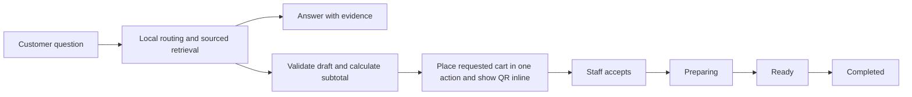

# Customer service workflow

## Runtime contract

One service owns money, validation, consent and transitions for HTTP and MCP. Staff accept local requests. Merchant mode posts customer-requested orders to Trend Coffee and reads its QR/payment status. Direct serve defaults to local queue; the kiosk launcher and project MCP enable merchant mode. See [merchant checkout](merchant-checkout.md) for delivery states, QR validation and retry rules. No outbound customer messages are sent.

Order transitions: `pending_acceptance → accepted/rejected/cancelled`, `accepted → preparing/cancelled`, `preparing → ready/cancelled`, `ready → completed/cancelled`.

Payment transitions: `unverified → paid/failed`, `failed → paid`, `paid → refund_pending`, `refund_pending → refunded/paid`. A cancellation does not refund funds. These are local staff records, not bank or merchant reconciliation.

Support: `queued_local → acknowledged → resolved`; `delivered` becomes true only on staff acknowledgment. Customer progress lists durable events, newest first. Failed delivery has no success claim.

## Ownership and tools

Customer HTTP routes and MCP expose menu, live merchant tables, evidence, guest memory, drafts, request submission, progress and handoff creation. Table questions use `/api/tables`, `get_tables` or native `kiosk_tables`; each reads the merchant API now instead of searching saved knowledge. See [merchant checkout](merchant-checkout.md) for automatic first-free-table selection and error behavior. Operator HTTP routes require `TREND_STAFF_TOKEN`; no staff tools are exposed through MCP. `/api/staff/queue` lists local requests; `/api/staff/orders/{id}` updates one state axis; `/api/staff/handoffs/{id}` acknowledges/resolves issues.

Customer checkout places the requested cart directly with no second confirmation or modal. The internal quote expires after five minutes. Its exact catalog fingerprint is checked on first submission. Subsequent submissions return the original request atomically. Menu snapshots older than 24 hours cannot produce new quotes; `sync-public` is an explicit operator action. Prices are listed-item subtotals: staff confirm availability, applicable discounts/fees and final merchant order.

## Memory and retrieval

Working state consists of quotes, requests and events in SQLite WAL. Customer preference memory is separate, consented and scoped to the secret guest token. Tokens are hashed in storage; clients retain the capability. Guest sessions and related records expire after 30 days and are purged during new-session creation. Preference deletion is immediate; order records remain until session expiry. No raw chat transcripts are stored. Protect database/backups as customer data; revoke a leaked capability by deleting the session and its dependent data through an operator maintenance process.

FTS5 searches accent-normalized Vietnamese text and returns approved, unexpired evidence plus URLs and verification dates. Evidence expires at most 30 days after verification; menu summary evidence expires after 24 hours and is replaced alongside catalog refresh. Explicit earlier expiries are respected. Menu/pricing use structured tools, never generated prose. The optional model only selects IDs from approved knowledge; its generated answers/actions are never executed. The four-second timeout returns an honest local fallback. Upstream keys and model names are configured outside source control.

## Completion checks

Check mismatched cup options, stale or changed prices, expired quotes, repeated submits, cross-session access, missing payment evidence and failed handoff acknowledgment. Measure in-process HTTP p50/p95/p99, cold start, errors and concurrent load. Actual customer network/model/POS latency requires separate deployment measurements.
