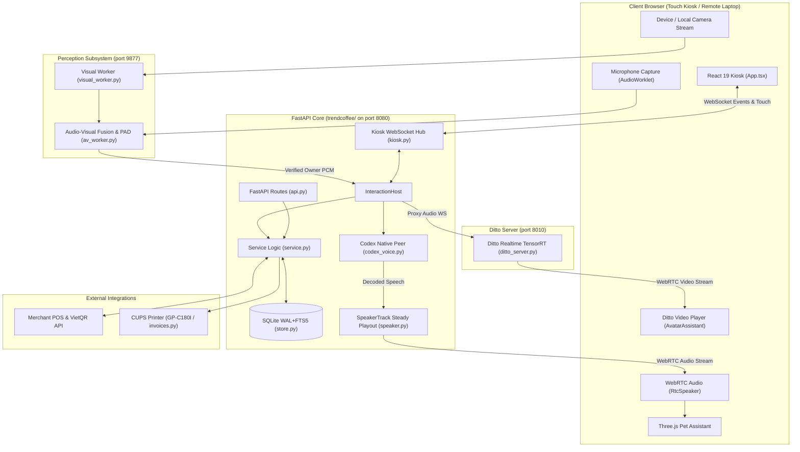

# Onboarding & Handoff Guide: Trend Coffee Kiosk

> **Target Project**: Trend Coffee Kiosk (`trendcoffee-agent` / `trendcoffee-kiosk`)  
> **Last Updated**: 2026-11-03  
> **Repository Root**: `/home/metek/Projects/OpenAIMK`  
> **Operational Status**: Active & Live (`merchant_api` mode, POS connected)

---

## 1. Executive Summary

**Trend Coffee Kiosk** is an autonomous, dual-mode (touch screen + native multimodal voice) ordering kiosk designed for Vietnamese specialty coffee shops. It provides real-time spoken customer service, menu recommendations, synchronized touch ordering, merchant POS integration with dynamic VietQR payment, order progress tracking, and automated CUPS invoice printing.

The system is built on a shared Python core (`trendcoffee/`) serving REST, WebSocket, and MCP protocols. Multimodal perception (audio/vision fusion via local camera and microphone) tracks customer presence and ensures only the authorized, facing customer commands the kiosk.

### Core Distinctions
- **Native Codex Voice**: Direct connection to native `gpt-6-luna` (medium reasoning, standard tier; Fast disabled on 2026-11-03 per user directive).
- **Two Assistant Personas**:
  - **Avatar 3D (Default)**: GPU-accelerated whole-face Ditto talking head (`ditto_server.py` on port 8010) streamed via WebRTC video.
  - **Pet (Added 2026-11-03)**: Procedural Three.js robot adapted from OpenJarvis, receiving real-time speech via WebRTC audio (`SpeakerTrack`).
- **Direct Order/QR Flow (Updated 2026-11-03)**: Delegated choice + fulfillment executes checkout in a single turn without repetitive sales dialogs.

---

## 2. Live System Status (As of 2026-11-03)

| Service | PID | Port | Health / Mode | Notes |
|---|---|---|---|---|
| **API** | `798586` | `8080` | `ok`, `merchant_api`, `live_pos_connected: true` | Serves REST, Kiosk WebSocket, static assets |
| **Visual** | `798527` | `9877` | Listening | Fusion IPC, face tracking, PAD |
| **Avatar** | `798566` | `8010` | Listening | Ditto TensorRT talking head, WebRTC video |

- **POS Connection**: Active merchant integration (`TREND_MERCHANT_ENABLED=1`). 100 tables tracked, ~92-93 tables currently available.
- **Microphone & Speaker**: Client browser typically accessed locally or via remote laptop (`fedora-2`) over SSH port forwarding (port 8080) and direct Tailscale connection.

---

## 3. Tech Stack Breakdown

| Layer | Technology | Key Details & Version Constraints |
|---|---|---|
| **Backend Runtime** | Python ≥ 3.12 | Managed with `uv` and `hatchling` build system |
| **API & Web Framework** | FastAPI (≥0.115,<1), Uvicorn | Async route handlers, strict Pydantic schemas, WebSockets |
| **Persistence** | SQLite (WAL mode + FTS5) | Schema managed in `trendcoffee/store.py`, raw SQL, zero external DB deps |
| **AI / Voice Model** | OpenAI Codex CLI App-Server | Model: `gpt-6-luna`, reasoning effort: `medium`, standard tier (Fast off) |
| **Audio Playout** | WebRTC (`aiortc` ≥1.14) & AudioWorklet | `trendcoffee/speaker.py` steady-clock playout buffer for Pet |
| **Perception & Fusion** | Local `Visual/`, `Audio/`, `Metric3D/` | Sortformer/TitaNet/TSE + VisionAudioBridge, C920 local camera priority |
| **Talking Head Engine** | Ditto (TensorRT / PyTorch) | Whole-face composite on `Female_staff_member_clean_v2.mp4` / standing clip |
| **Frontend UI** | React 19, TypeScript ~6.0, Vite 8 | Tailwind CSS 4, Radix UI primitives, Lucide icons, Be Vietnam Pro font |
| **Interactive 3D** | Three.js `0.185.1` | Procedural geometric Pet robot (`frontend/src/components/pet/`) |
| **Testing & Quality** | Pytest, Playwright, Vitest, Ruff, Oxlint, Prettier | 100-col formatting for both Python and TypeScript |

---

## 4. System Architecture



---

## 5. Directory & Module Map

```
/home/metek/Projects/OpenAIMK/
├── trendcoffee/                 # Python backend core package
│   ├── api.py                   # REST endpoints, auth, kiosk WS route
│   ├── kiosk.py                 # InteractionHost, shared cart, guest lifecycle
│   ├── service.py               # Core business logic, quotes, fulfillment, orders
│   ├── store.py                 # SQLite database initialization & queries (WAL/FTS5)
│   ├── speaker.py               # WebRTC SpeakerTrack steady playout buffer (Nov 3)
│   ├── codex_voice.py           # Native Codex prompts, app-server link, tool definitions
│   ├── native_peer.py           # Native voice WebRTC peer connection, RTP handling
│   ├── av_worker.py             # Audio-Visual Fusion worker, speaker gating
│   ├── visual_worker.py         # Face tracking, presence detection, PAD
│   ├── av_transport.py          # IPC transport between API and perception workers
│   ├── avatar.py                # WebSocket proxy to Ditto avatar server
│   ├── avatar_*.py              # Expression calibration, whole-face composite, blinks
│   ├── merchant.py              # Live merchant POS API client, VietQR generation
│   ├── invoices.py              # Automated invoice scheduling & PDF generation
│   ├── printer.py               # CUPS printer integration (GP-C180I)
│   └── cli.py / __main__.py     # CLI entry point (`trendcoffee serve / mcp`)
├── frontend/                    # React 19 Touch Kiosk application
│   ├── src/
│   │   ├── App.tsx              # Main UI layout: Menu, Cart, Navigation, Popups
│   │   ├── useKioskVoice.ts     # Voice connection state, mic handling, event routing
│   │   ├── speakerRtc.ts        # Client WebRTC receiver for Pet audio playback
│   │   ├── state.ts             # Reducer state management for touch ordering
│   │   ├── components/
│   │   │   ├── Cart.tsx         # Sidebar cart, notes, checkout triggers
│   │   │   ├── PetAssistant.tsx # Procedural Three.js Pet robot component
│   │   │   ├── AvatarAssistant.tsx # Ditto WebRTC video talking head display
│   │   │   ├── SettingsDialog.tsx  # Character selection (Pet vs Avatar 3D), voice
│   │   │   ├── OrderDialogs.tsx # Product detail popup (KFC style)
│   │   │   └── PaymentQr.tsx    # Live VietQR display and polling status
│   │   └── voiceAudio.ts        # Fallback AudioWorklet queue player
│   └── package.json             # Node dependencies and build scripts
├── scripts/
│   ├── kiosk.py                 # Process supervisor: start/stop/status of 3 services
│   ├── ditto_server.py          # WebRTC server for Ditto talking head (port 8010)
│   ├── ditto_realtime.py        # Real-time GPU inference pipeline (TensorRT)
│   └── prepare_voice_clips.py   # Offline greeting/farewell WAV generator
├── tests/                       # Pytest test suite (backend & browser automation)
├── docs/                        # Architecture specs, evals, and runbooks
│   ├── ONBOARDING.md            # Foundational architecture guide
│   ├── PROGRESS.md              # Chronological change log & decision record
│   ├── GLOSSARY.md              # Domain terminology & visual defect vocabulary
│   └── evals/                   # Specific test evidence (QR flow, latency, avatar)
├── data/                        # Catalog snapshots and public knowledge assets
└── output/                      # Evaluation media, review videos, test captures
```

---

## 6. Key Request & Data Lifecycles

### 6.1. Touch Checkout Flow
1. **Selection**: Customer browses categories or searches items in `App.tsx`.
2. **Product Popup**: Clicking an item opens `OrderDialogs.tsx` (KFC-style popup, direct option chips, localized quantity).
3. **Cart & Fulfillment**: Item is added to `Cart.tsx` with customized notes and fulfillment method (`Dine In` with Radix table selector, or `Takeaway`).
4. **Checkout Submission**: `POST /api/checkout` validates input schemas, verifies catalog freshness, computes integer prices, locks checkout ID, and registers the order in `Store`.
5. **Merchant Settlement**: `merchant.py` generates the official payment payload and returns a dynamic VietQR. UI renders `PaymentQr.tsx` and polls for payment confirmation.

### 6.2. Multimodal Voice Interaction Flow
1. **Presence & Enrollment**: Local camera detects a customer facing the screen. After presence is verified, `InteractionHost` initiates a new guest session.
2. **Microphone Gating**: Raw audio enters `av_worker.py`. AV Fusion confirms identity match and locks the customer's voiceprint before routing PCM to `CodexVoice`.
3. **Native Voice Processing**: Model `gpt-6-luna` processes the audio.
   - For greetings / drink suggestions: Responds in a warm, friendly-barista tone (2–3 short sentences, ≤40 words).
   - For orders: Directly calls `kiosk_cart` and `kiosk_checkout` without asking for repeated confirmations.
4. **Final Spoken Policy**: When `qr_available=true`, the model's entire final sentence is strictly:  
   `"Bạn quét QR trên màn hình để thanh toán nhé."`  
   Once payment is verified, the spoken response is strictly:  
   `"Đơn đã được thanh toán."`
5. **Playout (Pet Mode)**: `trendcoffee/speaker.py` holds native audio for ~500 ms in a steady-clock playout buffer, sending contiguous 20 ms frames over WebRTC to `speakerRtc.ts` to prevent browser NetEQ distortion.

---

## 7. Conventions & Invariants

### 7.1. Code & Style Rules
- **Python**: Strict `snake_case`, typed Pydantic models, Ruff formatting with 100-character line length. Domain exceptions must raise `ServiceError(code, status)` which FastAPI converts to localized JSON errors.
- **Frontend**: React components in `PascalCase`, hooks and utilities in `camelCase`. Prettier configured with single quotes, no semicolons, 100-character line width.
- **Async Safety**: Every async resource (WebSocket, peer connection, MediaStream) must have deterministic teardown tied to the session lifecycle.

### 7.2. Critical Invariants
- **No Hallucinated Success**: Never claim an order is placed or paid without verified backend tool results. QR presence does not equal payment.
- **Single-Turn Delegated Ordering**: If a customer says "chọn giúp mình món mang đi", the assistant must pick a genuine catalog item, add it to the cart, and trigger checkout in the same turn without asking "bạn có chốt không?".
- **Guest Generation Isolation**: Kiosk events carry a numeric `generation`. Outdated events from previous guests are rejected to prevent state leaks.
- **Avatar Whole-Face Mandate**: The Ditto talking head must use whole-face composition (`avatar_whole_face.py`). Never paste an isolated mouth onto video. 2D character mode was permanently cancelled.
- **Audio Clocks**: Native output and browser playback operate at 48 kHz mono.

---

## 8. Common Developer Tasks & Commands

### Backend Commands (from workspace root)
```bash
# Setup environment
uv sync --locked

# Run backend development server (local queue mode)
uv run trendcoffee serve

# Run backend tests
.venv/bin/pytest -q

# Run specific focused test
.venv/bin/pytest tests/test_speaker.py -v

# Code quality & formatting
.venv/bin/ruff check trendcoffee tests
.venv/bin/ruff format --check trendcoffee tests
```

### Frontend Commands (from `frontend/` directory)
```bash
# Install dependencies
npm ci

# Run development server (Vite on port 5173)
npm run dev

# Run unit tests
npm test

# Typecheck and production build (writes to trendcoffee/static/)
npm run typecheck
npm run build

# Code linting & formatting check
npm run lint
npm run format:check
```

### Operational & Kiosk Management
```bash
# Check status of owned background processes (Visual, Avatar, API)
.venv/bin/python scripts/kiosk.py status

# Start all kiosk services (starts API in merchant mode)
.venv/bin/python scripts/kiosk.py start

# Stop all kiosk services cleanly
.venv/bin/python scripts/kiosk.py stop

# Run browser voice integration smoke test (requires built frontend)
PYTHONPATH=tests:. .venv/bin/python tests/browser_voice_smoke.py
```

---

## 9. Current Open Issues, Limits & Decisions Log

1. **Remote WebRTC Speaker Playout (Pet Mode)**:
   - *Status*: The steady-clock playout buffer (`SpeakerTrack`, ~500 ms target, contiguous timestamps) in `trendcoffee/speaker.py` eliminates NetEQ drift during steady playback.
   - *Consideration*: If the client experiences network latency spikes over remote SSH/Tailscale tunnels, ensure buffer metrics (`speaker_transport.starvations`) are monitored.
2. **Ditto Avatar Throughput on RTX 3060**:
   - *Status*: Generates ~13-14 FPS on GPU, while display runs at 24 FPS. Visual acceptance is pending user review; `Female_staff_member_clean_v2.mp4` is the active source.
   - *Rule*: Never perform unmonitored GPU trials; maintain existing whole-face profile.
3. **Voice Latency & Model Tier**:
   - *Status*: Model is locked to `gpt-6-luna`, medium reasoning, Fast tier disabled. Useful answer latency is ~1.8–2.2 seconds.
4. **Printer Infrastructure**:
   - *Status*: Configured for GP-C180I thermal receipt printer via CUPS (`TREND_PRINT_QUEUE`). In testing/development, printers are simulated via fixtures without physical paper feeds.

---

## 10. Quick Reference: Where to Look

| I need to... | Inspect this file / directory |
|---|---|
| Adjust spoken voice prompts or barista tone | `trendcoffee/codex_voice.py` (`INSTRUCTIONS`) |
| Debug WebRTC audio playout / stutter | `trendcoffee/speaker.py` & `frontend/src/speakerRtc.ts` |
| Modify product popup, cart or touch layout | `frontend/src/components/` (`OrderDialogs.tsx`, `Cart.tsx`, `App.tsx`) |
| Change Three.js Pet animations or styling | `frontend/src/components/PetAssistant.tsx` & `petState.ts` |
| Modify pricing, menu options, or discount logic | `trendcoffee/service.py` & `store.py` |
| Troubleshoot POS connection or table availability | `trendcoffee/merchant.py` & `trendcoffee/api.py` (`/api/tables`) |
| Inspect recent design decisions & test logs | `docs/PROGRESS.md` & `docs/evals/` |
| Check visual defect vocabulary (Vietnamese) | `GLOSSARY.md` |
